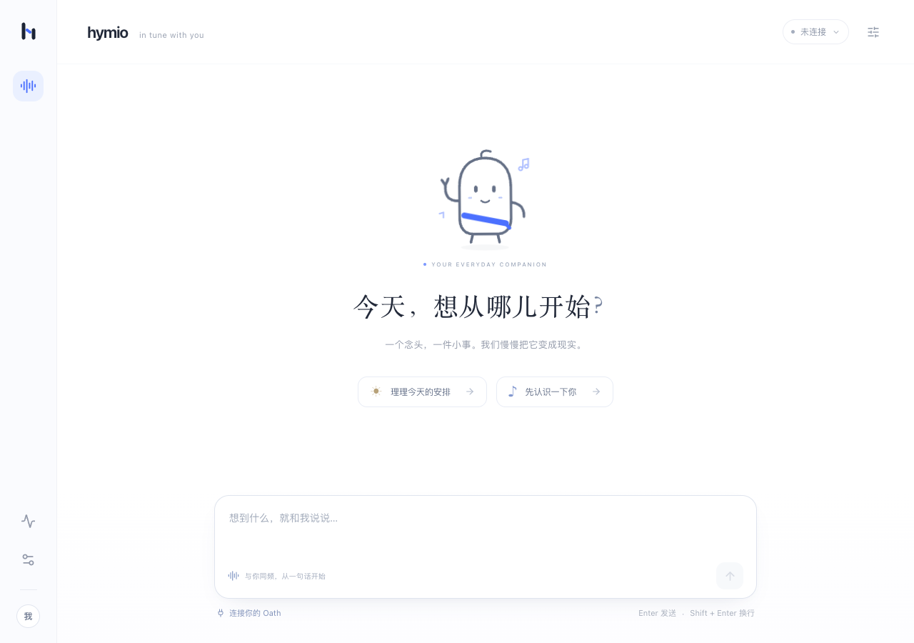

# Hymio

**Your personal AI agent, in tune with you.**

Hymio is the application layer of [HymioSpace](https://github.com/HymioSpace). It brings the agent, personal context, connectors and everyday applications into one experience across desktop, web, iOS and Chrome.

[Oath](https://github.com/HymioSpace/Oath) runs the agent. [Nostalgia](https://github.com/HymioSpace/Nostalgia) manages personal context. Hymio owns the product: accounts, authorization, imports and sync, Kits, clients and deployment.

**Status:** Web/Tauri client MVP. Connect to a running Oath deployment for one persistent conversation, streamed replies, offline replay and event/Trace inspection. The OIDC login backend is available; A local stack launcher is available; Nostalgia integration and production deployment remain future work.

<p align="center"></p>

## One product, several clients

Web and the Tauri desktop app share one frontend. Chrome can reuse shared web components and protocol packages while keeping its own background tasks and permissions. iOS has a separate platform implementation within the same repository.

A user has one ongoing agent conversation across clients. Closing a client does not end work accepted by Oath; reconnecting clients receive persisted progress. Context and Kit data are shared through their service APIs.

## Repository

| Directory | Responsibility |
| --- | --- |
| [apps/client](apps/client/README.md) | Shared web frontend and Tauri desktop shell |
| [apps/chrome](apps/chrome/README.md) | Browser extension, page capture and background tasks |
| [apps/ios](apps/ios/README.md) | iOS client and native platform capabilities |
| [packages](packages/README.md) | Shared UI, A2UI rendering, protocols and client communication |
| [backend](backend/README.md) | Accounts, authorization, connectors, context ingress and product APIs |
| [extensions](extensions/README.md) | Hymio-specific Oath skills, tools and CLI commands |
| [kits](kits/README.md) | Applications that expose operations to agents and experiences to users |
| [deploy](deploy/README.md) | Product deployment and dependency composition |
| [spec](spec/README.md) | Architecture and feature designs |

Apps and services may build and release independently. Sharing a repository does not require sharing platform-specific UI or deploying every module as a separate service.

## Runtime and context

Oath and Nostalgia remain independent projects. Integrate through their public protocols and versioned artifacts; keep their core implementations out of Hymio. No Git submodules are required by this scaffold.

Hymio's deployment layer starts the local backend, Casdoor and Oath; Nostalgia remains future work. Clients connect to the configured services. The current Oath command already accepts external extension directories; Hymio provides the directories in [extensions](extensions/README.md).

## Start here

For a complete local login-enabled stack, complete the one-time setup in the
[deployment guide](deploy/README.md), then run from the repository root:

```bash
uv run --python 3.12 --no-project python deploy/start.py --client web
# Desktop instead: --client desk; services only: --client none
```

The launcher starts Casdoor, Backend and Oath before the chosen development client.
Ctrl+C closes Backend/client while leaving Docker services and Agent work running.

### Client only

Requires Node.js 22.12+ and pnpm 11. Start [Oath](https://github.com/HymioSpace/Oath) separately, then:

```bash
git clone https://github.com/HymioSpace/Hymio.git
cd Hymio/apps/client
pnpm install
pnpm dev       # Web: http://127.0.0.1:1420
# Or, with Rust and Tauri platform prerequisites:
pnpm desktop
```

Follow the [backend guide](backend/README.md) to configure account registration or Google login. The client opens a dedicated sign-in screen; deployment addresses are configured by the operator in `apps/client/client.toml`, never entered by end users. Oath keeps executing accepted work when the client leaves.

Read the [client guide](apps/client/README.md) for builds, debug controls and production Web routing. React/TypeScript/Vite and Tauri 2 share the frontend. The Python backend integrates Casdoor through standard OIDC.

See the [overview](spec/overview.md), [client design](spec/feature07-client-mvp.md) and the [feature plans](spec/README.md) for module boundaries.

Shared development conventions live in `spec/README.md`. Local `AGENTS.md`, credentials, private extensions and runtime data are ignored by Git.
