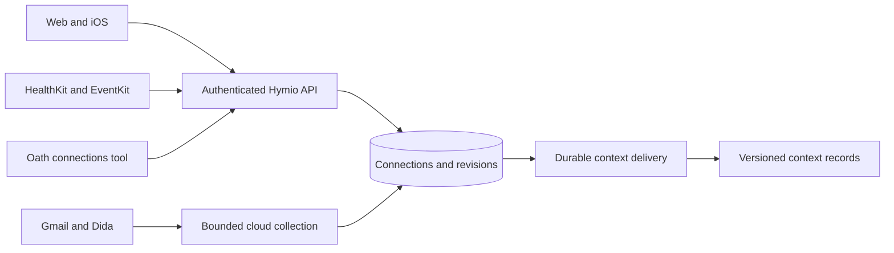

# Connections

Connections bring selected external sources into Hymio's personal context. Connect from
**My account → Connections**. Each source asks for consent separately. The first version is
read-only: it cannot send email, complete external tasks, edit calendars or write health samples.

## Available sources

| Source | Web | iOS | Collection |
| --- | --- | --- | --- |
| Gmail | Authorize, inspect, pause, disconnect | Same | Recent inbox, then incremental history |
| 滴答清单 / Dida | Authorize, inspect, pause, disconnect | Same | Project tasks and recent completed tasks |
| Apple Calendar | Inspect phone sync status | Select calendars and sync | Past 7 through next 30 days |
| Apple Health | Inspect phone sync status | Consent and sync | Last 7 days of daily steps and active energy; HealthKit changes schedule background refreshes |

Cloud sources normally poll every 15 minutes; bounded bootstrap pages continue sooner. Sync now
requests a run; it does not keep the HTTP request open for collection. Calendar sync remains
explicit while the app is in the foreground. Apple Health registers HealthKit observer queries
for step and active-energy changes; iOS decides when a background update is delivered, normally
no more than hourly. A persisted pending marker makes a failed upload retry on the next observer
event or app activation. Pending markers and cached connection IDs are account-scoped;
account changes invalidate old callbacks and in-flight upload work. This is not real-time delivery and does not survive a force-quit as a
background promise. The UI shows synchronization receipts and pending context delivery separately.
Imported content is source material, never an instruction to the agent.

## Private deployment configuration

Without OAuth registrations, Gmail and Dida show **deployment configuration required**. Register
your own applications; no shared client credentials are shipped. Google login configuration and
Gmail API authorization are separate.

Either set a complete credential pair in the Backend process environment or provide a private
JSON file. Environment values take precedence. Partial environment pairs are not used, so a
missing secret cannot silently combine with another credential source.

```sh
export DIDA_CLIENT_ID="..."
export DIDA_CLIENT_SECRET="..."
# Optional when Gmail becomes available:
export GMAIL_CLIENT_ID="..."
export GMAIL_CLIENT_SECRET="..."
```

The generated cloud Compose configuration forwards these named variables without embedding their
values in the generated YAML. Export them in the deployment environment, or place them in a
private Compose `.env` file, before starting the stack.

1. Create a private JSON file outside the checkout, for example
   `/etc/hymio/private/connectors.json`, readable only by the backend account (`chmod 600`).
2. Set `connectors_config_file` in the backend's existing configuration, or
   `HYMIO_CONNECTORS_CONFIG_FILE` to its **container-visible absolute path**. Mount the private
   directory read-only when using Docker. Restart the backend after changing configuration.
3. Populate only providers you have registered:

```json
{
  "gmail": {"client_id": "YOUR_GOOGLE_WEB_CLIENT_ID", "client_secret": "YOUR_GOOGLE_CLIENT_SECRET"},
  "dida": {"client_id": "YOUR_DIDA_CLIENT_ID", "client_secret": "YOUR_DIDA_CLIENT_SECRET"}
}
```

Do not commit this file, client secrets, tokens, database files or encryption keys.

### Gmail registration

Use [Google Cloud Console](https://console.cloud.google.com/apis/credentials): enable Gmail API,
configure the consent screen, and create a Web OAuth client. Register exactly:

```text
https://YOUR_HYMIO_HOST/connectors/oauth/gmail/callback
```

Use the backend's `public_url` as the origin. Local development can use the provider-supported
localhost HTTP callback. Request only `https://www.googleapis.com/auth/gmail.readonly`.
It is a **restricted scope**: distributing to other users can require Google's verification and
security requirements. Until approved, follow Google's test-user restrictions. Hymio uses
single-use state, PKCE and offline access; it never asks users to paste provider tokens.

### Dida registration

Register at [Dida developer platform](https://developer.dida365.com/) and configure:

```text
https://YOUR_HYMIO_HOST/connectors/oauth/dida/callback
```

The implementation uses domestic Dida endpoints and `tasks:read`, not international TickTick.
The documented token flow does not guarantee refresh support; an expired token asks the user to
reconnect. The API's bounded completed-task query covers recent history. Missing tasks are **not**
assumed deleted: the last observed snapshot and its sync time remain visible.

### Apple / TestFlight

Build a new iOS binary; a backend deployment cannot add native permissions to an installed app.
Enable both HealthKit and **HealthKit Background Delivery** for the app's Apple Developer
identifier and regenerate provisioning as needed. The project includes both entitlements and
read-purpose strings. This release requests only steps and active energy; there is no health-write
entitlement or write API. It does not request Clinical Health Records.

Before the system permission sheet, the user explicitly agrees to upload selected data to their
Hymio server, personal context and configured AI models. Calendar reading requires Apple's full
calendar access permission even though Hymio itself performs no writes. Users select calendars;
notes, attendees and locations are excluded. Revoking OS permissions happens in iOS Settings.

HealthKit deliberately does not disclose read authorization status. No readable samples means
**no data available**, not zero activity and not proof of refusal. Simulator UI tests do not verify
real HealthKit samples, signing, provisioning or background delivery. Verify these on a physical
phone before distributing the build, including a change-triggered background upload and a failed
network retry after reopening the app. Publishing also requires an accurate privacy policy and App
Store privacy disclosures for your deployment's data handling.

## Architecture and recovery



Connection ownership comes from the authenticated session, never the provider's user ID.
Device uploads additionally match the bound installation. Internal tools use the existing trusted
service identity plus execution user. Oath only gets list/read operations, not credentials.

SQLite persists connections, encrypted tokens, due times, checkpoints, bounded recent run
receipts, current items and pending source revisions. Network requests run outside transactions.
A fenced lease prevents late workers from advancing newer state. Cursor advancement and source
revisions commit atomically. Native snapshots reject older capture times and conflicting retries.
Calendar deletion reconciliation only applies to a complete, selected-calendar window.

Nostalgia delivery is retried independently, with stable operation identities and the last
acknowledged record ID. Conflicts are retained for investigation rather than overwritten. Source
changes remain durable if context storage is unavailable. Agent reads include source freshness
and connection state; tool text is bounded. Historical source revisions are retained; this is not
an automatic source-data purge service.

### Backup and disconnect

A Fernet encryption key is generated next to the backend database with suffix `.connectors.key`
and file mode `0600`. **Back up that key with the database**, keep both private and restore them
together. The backend data directory must be persistent. Losing the key requires reconnecting
cloud accounts; it cannot decrypt the existing tokens.

Pause stops collection. Disconnect disables the connection, invalidates in-flight work and removes
its local credentials. Provider revocation is best effort; if unconfirmed, revoke access in the
provider account settings too. Previously imported context is retained, as the UI explains.
Disconnection is not a promise to erase Nostalgia history or derived memories.

## Developer API

| Endpoint | Purpose |
| --- | --- |
| `GET /connectors` | Catalog and owned connections; no credentials |
| `POST /connectors` | Create after explicit consent |
| `POST /connectors/{id}` | `sync`, `pause`, `resume`, `disconnect` |
| `POST /connectors/{id}/authorize` | Short-lived OAuth flow |
| `POST /connectors/{id}/ingest` | Validated, installation-bound native snapshot |
| `GET /connectors/oauth/{provider}/callback` | Single-use state callback |
| `POST /internal/connectors/call` | Trusted, user-scoped list/read tool |

Add providers by extending the closed catalog, an adapter producing normalized source items and
checkpoint, and platform consent UI. Never accept arbitrary OAuth/token/API URLs or scopes from
a caller. Add adapter, replay, owner isolation, failure and recovery tests. Keep provider writes
out of this read-only contract; a later write capability requires its own authorization design.

## References and visual assets

- [Gmail scopes](https://developers.google.com/workspace/gmail/api/auth/scopes),
  [incremental sync](https://developers.google.com/workspace/gmail/api/guides/sync),
  [OAuth web server flow](https://developers.google.com/identity/protocols/oauth2/web-server).
- [Dida OpenAPI](https://developer.dida365.com/docs/openapi.md).
- [EventKit access](https://developer.apple.com/documentation/eventkit/accessing-the-event-store),
  [HealthKit authorization](https://developer.apple.com/documentation/healthkit/authorizing-access-to-health-data).
- Gmail mark: Google's [product icon](https://www.gstatic.com/images/branding/product/2x/gmail_2020q4_48dp.png).
  Dida mark: Dida's [site app icon](https://cncdn.dida365.com/web/static/img/apple-touch-icon-180x180.png).
  These identify their respective services; their trademarks are not relicensed under this
  repository's code license. Calendar/health UI marks are locally drawn interface elements.

For synthetic UI previews use Web `/design.html?connectors` or the iOS Debug launch argument
`-HymioConnectorsPreview`. Preview receipts are examples, not real account data.
