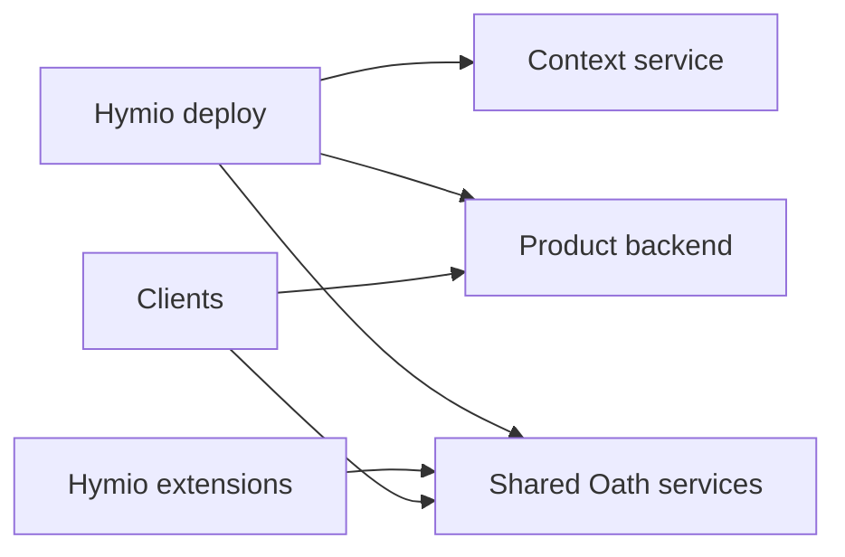

# Feature 05 — 产品部署与外部依赖

状态：Draft；依赖 Oath 部署产物与待实现的 Hymio backend、Nostalgia。

## 总览

Hymio 的部署层启动整套产品。Oath 提供 runtime 镜像、服务配置和独立命令；Hymio 选择其版本、配置与产品扩展，并组合 backend 与 Nostalgia。客户端连接已经运行的服务。

## 依赖方式

应用源码归属以 [feature06](feature06-application-monorepo.md) 为准。Oath、Nostalgia 独立维护，部署优先引用固定版本镜像/产物与契约；本次没有 submodule、镜像版本锁或可运行组合 Compose。

需要联合开发外部源码时才添加 Git submodule，固定 commit，并显式更新 gitlink。子仓库先提交和发布，父仓库再更新引用。公开默认构建不能依赖私有仓库访问权限。

## 启动职责

近期可由部署入口调用 Oath 的 `oath start` 并传入 skill/tool/CLI 目录，Hymio 与 Oath 两套 Compose 的网络、端口、配置和数据归属必须显式处理。

整套产品入口成型后，统一 Compose/部署平台直接编排 Oath 服务与产品服务。后端请求处理、模块 import、用户登录和 WS 连接都不启动整套 Oath。桌面端若提供本地部署管理，应作为显式平台能力。

一个部署为多个用户提供共享 Oath 服务，由其有界 Worker 池调度。Oath Biz 承载 runtime trace 与 CLI；Hymio backend 承载产品账号和业务 API，两者名称与职责不能混用。

## 配置与边界

部署配置包含端点、依赖版本与 secret 引用。Oath 模型密钥继续通过其 Vault 机制处理；Hymio 连接器密钥的托管方案需另行选定，不把真实值写进模板、Context 或客户端包。

扩展通过显式只读目录挂载。当前 `oath start` 会调用独立 Compose，并不自动为外部 Hymio 后端建立网络可达性；端点配置和网络规则属于组合部署设计。

Oath 当前默认是单机 SQLite owner、单节点 RabbitMQ 和 Vault。多个独立服务不等于多机高可用；联合部署同样不得宣称自动故障切换。Hymio 业务存储的选择仍未确定。

## 失败与恢复

启动时检查配置、依赖健康与契约兼容，再发布可用状态。缺少必需依赖明确失败；可选私有能力缺失不能阻止公开基础构建。

停止产品需明确接纳停止、执行收敛与持久事件交付的边界；不能通过杀掉客户端来模拟可靠关机。备份分别覆盖产品业务数据、Nostalgia 数据、Oath 持久卷及 Vault 恢复文件。
