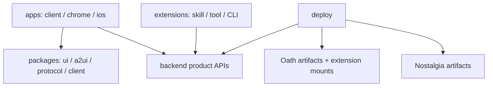

# Feature 06 — 应用层 Monorepo

状态：Implemented；范围仅为仓库目录、文档与基础编辑配置。

## 总览

Hymio 在一个仓库中维护产品客户端、共享包、后端、Agent 扩展与部署。需要共同修改的代码可以在一个 PR 中交付，各应用保留独立构建和发布边界。Oath 与 Nostalgia 保持独立项目。

## 代码归属

- `apps/client` 维护 Web 与 Tauri Desktop 的共用前端，原生能力通过平台适配调用。
- `apps/chrome` 维护 extension 入口、background、content scripts 与权限，可复用共享 Web 包。
- `apps/ios` 维护平台实现；原生视图不依赖 Web 组件。
- `packages/ui` 只负责表现；`a2ui` 负责渲染数据与发出用户动作；`protocol` 保存 Hymio 契约；`client` 负责通信与事件交付。
- `backend` 维护统一账号、授权、连接器、导入同步、Kit registry 与产品设置。
- `extensions` 维护装入 Oath 的产品能力。CLI handler 在 Oath Biz 执行，产品后端仍是独立服务。
- `kits` 维护业务 API、数据约束与可选 UI。应用外壳与导航归各 app。
- `deploy` 组合产品服务与固定依赖产物，不要求为每个用户启动一套 Oath。

## 依赖约束

共享包不依赖具体 app。平台调用经适配器注入，Web 构建不能要求存在 Tauri host。Web/Tauri/Chrome 共享适合它们的 UI；iOS 复用协议、tokens 与资源，不强求共用所有视图实现。

Oath 与 Nostalgia 的 wire schema 由上游维护。Hymio 可以从固定版本生成适配类型，不在本仓库维护第二套执行或 Context 核心实现。协议变更同时检查受影响的 app、package 与 adapter。

`user_id` 映射到产品用户；设备有稳定 `client_id`。不引入 session，也不让 UI 开关控制已接纳工作的生命周期。

## 仓库与产物

目录是源码归属，包是代码依赖，镜像/安装包是发布产物，三者不必一一对应。待首个前端实现确定工具链后再添加 workspace manifests 与真实构建命令；本次不生成无可执行内容的工程。

已有独立 Hymio-iOS/Hymio-Chrome 仓库不成为默认依赖，也不在初始化中搬迁源码。未来实现采用此 monorepo 时，单独处理必要内容的迁入与旧仓库说明。

Git submodule 只在需要固定版本联合开发外部源码时引入。常规部署使用版本化产物；不能靠一个普通嵌套 `.git` 目录代替正式依赖。

## 私有能力与失败边界

私有扩展放显式外部目录或忽略的 `extensions-local/`，公开构建不依赖私有凭据。配置只保存 secret 引用。模块目录存在不代表服务已实现或接口可调用；README 与 feature 状态必须反映实际能力。

客户端缺少某个平台 UI 时，仍可通过通用对话或已有业务 API 使用已支持的能力；不得将未实现的渲染、授权或部署降级为静默成功。
