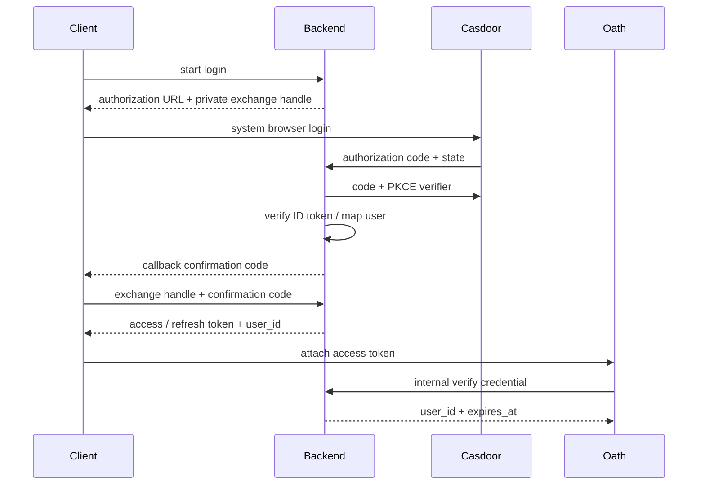

# 登录与 Oath 身份接入

状态：Implemented

## 总览

Hymio Backend 通过 OIDC 接入 Casdoor，维护稳定的产品 user_id 和应用登录状态。客户端只登录一次，应用 access token 可用于 Backend 与 Oath；Oath 远程验证协议只依赖 user_id / expires_at，不依赖 Casdoor。

## 登录

Backend 是单独的 Python/Starlette 服务，使用 SQLite 保存用户、一次性登录事务与应用凭证。OIDC 使用 code flow、S256 PKCE、state、nonce，校验签名、issuer、audience 和过期。账号按 issuer + subject 唯一映射到随机稳定 user_id，不能由邮箱或客户端指定。Casdoor 独立部署，Hymio 只持有其服务端 client secret 文件。

Web 新窗口、Desktop 系统浏览器打开授权 URL。发起客户端持有随机 exchange handle；浏览器回调仅提供一次性确认码，必须与 handle 一起兑换应用凭证。Web 用 postMessage 返回原窗口，并校验发送窗口与 Backend origin；Desktop 使用临时 loopback 回调。仅复制授权 URL 无法从异地领取凭证。事务 5 分钟失效、callback 与领取仅一次；state、handle 与确认码相互独立。取消或失败只结束本次登录。

## 凭证与退出

应用 access token 15 分钟、refresh token 30 天，均为随机不透明串，数据库只存哈希。刷新原子轮换 refresh token，并撤销旧 access；同一刷新链复用旧 refresh 会撤销该登录。客户端刷新串行化，成功后重连 WS。退出撤销该登录全部凭证并断开本机 WS，不影响已接纳任务。Casdoor SSO 与 Hymio 登录独立：本次实现退出 Hymio，不做跨应用 SSO logout。

客户端凭证保存在当前窗口 sessionStorage；关闭窗口后重新登录。暂不承诺桌面长期登录。登录服务不可用时不自动退回无鉴权。客户端只接受 Hymio 登录凭证，不提供直连 Oath 或本机凭据读取。旧版存储的端点/凭据在升级时清理，只有当前部署的 Hymio session 可恢复。

## 服务边界

`POST /internal/auth/verify` 以单独服务凭据保护，接收 credential，返回 user_id / expires_at。Gateway/Biz 使用同一实现。`GET /agent/traces` 与 `/agent/traces/{id}` 是 Backend 代表已认证用户转发到 Biz 的示例。用户身份始终从凭证取得，不接受 query 中指定 user_id。

Backend 配置集中在私有 TOML，secret 仅引用文件。公开示例不包含凭据。日志不包含授权 code、token、callback query。CORS 仅配置的客户端 origin，HTTP 超时与请求大小有界。数据库和私有配置被忽略。生产入口使用 HTTPS，Oath 使用 WSS；none 模式只用于可信部署。

## 范围

提供可运行 Backend、OIDC 登录、刷新、退出、远程验证、Web/Desktop 登录入口与部署说明。连接器授权、用户资料编辑、跨设备退出、Casdoor SSO logout 后续实现。

参考：[Casdoor 标准 OIDC](https://casdoor.org/docs/category/how-to-connect-to-casdoor/)、[Docker 部署](https://casdoor.ai/docs/deployment/docker/)。

## 登录界面与 Google

未登录先展示独立账号入口，登录成功才进入对话；退出回到入口。服务地址由 apps/client/client.toml 的公开 backend_url 构建配置确定，不允许用户编辑。此文件只含公开服务地址；更换部署需要重新构建客户端。客户端没有 Vite 本机配置读取接口、原生 local_oath_profile 或无鉴权回退。Biz 查询通过已登录 Backend 的代理，WS 地址由登录响应提供。

GET /auth/options 仅公开 login_method（account / google）。默认账号入口使用下述 Hymio 自有表单；google 表示部署者已配置 Google-only 应用（关闭表单登录、绑定 Google Provider、允许注册），Casdoor 自动转到 Google。两种模式复用 OIDC code + PKCE 验证和应用 session，不另外实现 Google token 处理，不按 email 合并用户。Google 首次登录由 Casdoor 注册，Hymio 仍按 issuer + sub 映射。该配置不是 Google 开关，不能代替 Provider 凭据与应用权限。

Google Web OAuth 凭据只进入 Casdoor；Google callback 为 Casdoor /callback，不是 Hymio /auth/callback。登录仅需身份资料，不申请 Gmail 邮件访问权限。没有配置 Google 前保持 account，不展示无法工作的 Google 按钮。

## Hymio 自有账号表单

账号模式在 Hymio 页面内完成注册、登录，仅收集用户名和密码。显示名默认取用户名，不收集邮箱和手机号。Backend 的 POST /auth/account 接收 action（login / signup）、username、password；Casdoor 专属 adapter 通过已配置 client_id 获取应用/组织，提交公开账号 API，取得绑定 S256 PKCE 和 nonce 的授权码，再经现有 OIDC 验证和应用 session 签发。客户端不能指定组织、应用、user_id、callback 或权限。

用户名 3–32 位字母/数字/下划线/连字符；注册密码 8–128 字符，已有账号登录允许原密码。密码仅在本次请求内传递给 Casdoor，不持久化、不日志记录；生产两段链路都使用 HTTPS。每次账号操作使用独立 HTTP client，避免不同用户复用 Casdoor cookie。支持 Plain/AES 密码混淆；不绕过 Casdoor 的注册开关、密码策略、CAPTCHA、MFA 或 consent；需要额外验证时明确失败，浏览器 OIDC 路径继续用于 Google。表单不宣称支持密码找回、MFA 或短信。

Casdoor 必须使用独立 Hymio organization：built-in 是管理组织，禁止自助注册。本机开发的应用可仅启用用户名、显示名、密码和确认项，邮箱/手机号隐藏且不必填，Agreement 项不要求，不能由后台伪造用户同意；不把未验证邮箱当作身份。注册和登录都经服务端检验，不能通过隐藏前端字段规避提供方策略。
