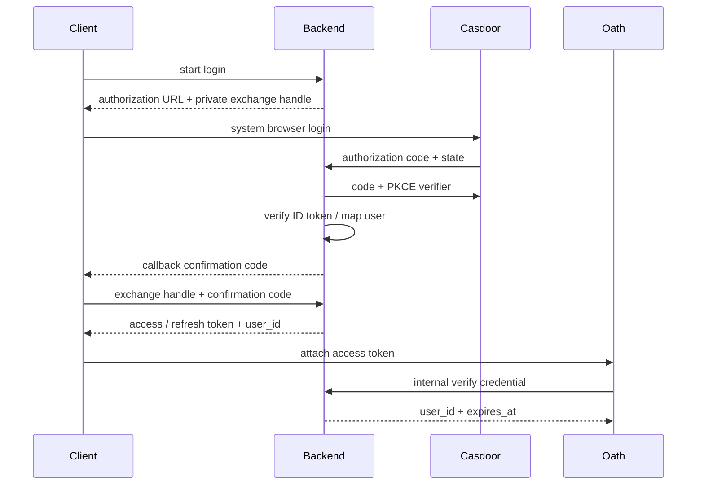

# 登录与 Oath 身份接入

状态：Implemented

## 总览

Hymio Backend 通过 OIDC 接入 Casdoor，维护稳定的产品 user_id 和应用登录状态。客户端只登录一次，应用 access token 可用于 Backend 与 Oath；Oath 远程验证协议只依赖 user_id / expires_at，不依赖 Casdoor。

## 登录

Backend 是单独的 Python/Starlette 服务，使用 SQLite 保存用户、一次性登录事务与应用凭证。OIDC 使用 code flow、S256 PKCE、state、nonce，校验签名、issuer、audience 和过期。账号按 issuer + subject 唯一映射到随机稳定 user_id，不能由邮箱或客户端指定。Casdoor 独立部署，Hymio 只持有其服务端 client secret 文件。

Web 新窗口、Desktop 系统浏览器打开授权 URL。发起客户端持有随机 exchange handle；浏览器回调仅提供一次性确认码，必须与 handle 一起兑换应用凭证。Web 用 postMessage 返回原窗口，并校验发送窗口与 Backend origin；Desktop 使用临时 loopback 回调。仅复制授权 URL 无法从异地领取凭证。事务 5 分钟失效、callback 与领取仅一次；state、handle 与确认码相互独立。取消或失败只结束本次登录。

## 凭证与退出

应用 access token 15 分钟、refresh token 30 天，均为随机不透明串，数据库只存哈希。刷新原子轮换 refresh token，并撤销旧 access；同一刷新链复用旧 refresh 会撤销该登录。客户端刷新串行化，成功后重连 WS。退出撤销该登录全部凭证并断开本机 WS，不影响已接纳任务。Casdoor SSO 与 Hymio 登录独立：本次实现退出 Hymio，不做跨应用 SSO logout。

客户端凭证保存在当前窗口 sessionStorage；关闭窗口后重新登录。暂不承诺桌面长期登录。登录服务不可用时不自动退回无鉴权。直接连接本机 Oath 保留在连接设置中，明确提供 user_id。

## 服务边界

`POST /internal/auth/verify` 以单独服务凭据保护，接收 credential，返回 user_id / expires_at。Gateway/Biz 使用同一实现。`GET /agent/traces` 与 `/agent/traces/{id}` 是 Backend 代表已认证用户转发到 Biz 的示例。用户身份始终从凭证取得，不接受 query 中指定 user_id。

Backend 配置集中在私有 TOML，secret 仅引用文件。公开示例不包含凭据。日志不包含授权 code、token、callback query。CORS 仅配置的客户端 origin，HTTP 超时与请求大小有界。数据库和私有配置被忽略。生产入口使用 HTTPS，Oath 使用 WSS；none 模式只用于可信部署。

## 范围

提供可运行 Backend、OIDC 登录、刷新、退出、远程验证、Web/Desktop 登录入口与部署说明。连接器授权、用户资料编辑、跨设备退出、Casdoor SSO logout 后续实现。

参考：[Casdoor 标准 OIDC](https://casdoor.org/docs/category/how-to-connect-to-casdoor/)、[Docker 部署](https://casdoor.ai/docs/deployment/docker/)。
