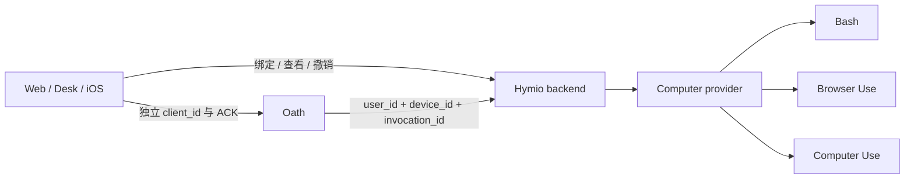

# 多设备与执行环境

状态：Implemented（第一阶段，E2B Desktop）

## 总览

一个 user_id 只有一个 Agent 和一段对话。设备是输入渠道或执行目标，不是会话。
Hymio 管绑定、能力、执行路由；Oath 管工具生命周期。Kit 不属于本阶段。

规则：身份来自凭据；工具必须显式指定 device_id；已提交操作不随客户端切换目标；
设备离线不停止 Agent，也不回退到 Oath 宿主机。

## 第一阶段

- 设备归属与撤销、能力查询；手机和 Web 只作为渠道，不宣称可控。
- 云电脑统一 Bash / Browser / Desktop；仅接入 E2B Desktop 托管环境。
- Browser 通过 Playwright 连接桌面 Chromium，同一 profile、下载目录和文件系统。
- 每个客户端独立接收历史事件；设备 ID 与用于投递的 client_id 分开。
- Mac 原生控制、云安卓、自动休眠策略和跨区域调度后续实现。

## 设备与命令

设备持久化 device_id、user_id、kind、name、provider、provider_ref、generation、
last_seen、revoked_at。能力按 provider 推导；provider_ref 只在服务端存储。
客户端不得指定其他用户归属。web / mac / ios 安装绑定支持心跳与撤销；mac 首版最多一个。
mac / cloud_desktop / cloud_android 可作为执行目标；ios / web 只承载输入和显示。

命令以 (user_id, invocation_id) 唯一，记录参数摘要、device_id、generation、
deadline、status 和 result。重复请求返回同一次操作；参数不同则冲突。
第一阶段直接认领为 running → succeeded / outcome_unknown；命令退出码和超时放在结果中。
已被占用的设备返回 busy，不排队。验证参数在认领前完成。
崩溃后的 running 不自动重跑；无法确认副作用时返回 outcome_unknown。

设备撤销阻止新命令；已执行的副作用不承诺撤回。连接重建不改变设备归属。
所有执行操作同一设备串行；Bash 也可能改变桌面，不能绕过控制锁。
人工接管和实时视频尚未提供；未来接管必须阻止 Agent GUI 操作，显式归还后继续。

## 多端进度

Oath outbox 是 user_id 下的连续 event_seq。ACK 按 (user_id, client_id) 保存，
不能用 user_id 或 device_id 共用一个 ACK。每类渠道仅允许一个活动连接，新连接接管旧连接；Web、iPhone、Mac 可同时在线。详见 [Trace 与设备可用性](feature18-trace-devices.md)。
客户端先持久化事件，再确认连续进度；发现缺口就重新请求历史，不跨过缺口 ACK。
本机缓存损坏时换投递 client_id，从完整历史恢复。缓存与 pending command 按账号隔离。
输入带 source_device_id、client_id、已接收 cursor；它们是上下文，不能作为授权凭据。

## 调用契约

设备 API 使用 Hymio 登录凭据。Oath 扩展使用独立服务凭据，user_id 来自
ToolInvocation.user，不能从模型参数读取。所有查询和调用都校验设备属于该用户。
服务凭据不传给设备命令环境，不进入 prompt / trace。

工具：devices（列可用目标）、bash（device_id + command + cwd）、
browser（device_id + action + 参数）、computer（device_id + action + 参数）、
device_command（device_id + 原 invocation_id，只查询执行状态与结果）。
它只接受 `bash`、`browser`、`computer` 产生的设备 invocation；媒体、任务、技能和
subagent 结果不能通过它查询。非设备 invocation 返回明确的 `not_a_device_invocation`。
结果始终包含 device_id。截图存为受鉴权媒体资源；工具返回引用，不把 Base64 塞进对话。
模型通过设备清单了解能力；上下文明确宿主机与云电脑不同，不能猜默认设备。

## Provider 与持久化

统一 provider 接口提供 provision / state / inspect / execute / pause / resume / stop。
手动 pause / resume 已提供；自动闲置调度与数据备份仍是后续能力。
不把供应商 ID 暴露成设备 ID。撤销 E2B 沙箱会销毁数据，需明确确认。
E2B 需要私有 API Key 和定制 Desktop template（含独立 Python/Playwright 环境），
Browser 操作先激活桌面 Chrome 窗口；连接时间计入命令 deadline。
重连原 sandbox；沙箱不存在时报告 unavailable，
不静默创建空环境冒充恢复。E2B full pause / restore 已实测保留桌面内存；手动恢复不会创建新沙箱。

## 失败与恢复

Provider 请求有 deadline；HTTP 断开不能证明命令没执行。执行前持久化 running，
执行后先保存结果再响应。超时或崩溃后的不确定命令不自动重放。
设备状态实时查 provider，离线是能力不可用，不是解除绑定。
通过 SQLite 事务认领命令与设备控制权，不靠进程内锁保证幂等。
未知命令不通过暂停/继续解除。需要部署者调查，或由用户确认数据损失后撤销并重新创建。

## 生命周期与操作记录

暂停、继续与工具执行共享持久控制锁。控制期间不接纳新命令；暂停时有运行中
或结果未知的命令则拒绝暂停。E2B 使用完整暂停，
恢复原沙箱的桌面和浏览器。状态查询只读，绝不能通过 connect 顺便恢复沙箱。
控制过程写 changing；成功写 active / paused，失败保留 recovery_required 与控制锁。
明确的 resume 可重试过期的控制操作；不能用 resume 清除未知工具命令。

执行记录按用户和设备查询，包含 invocation_id、请求、状态、耗时与结构化结果。
查询历史不触发重跑；超时仍未返回的运行显示 outcome_unknown。
浏览器标签页使用明确 page_id，未指定时操作当前前台页；不能永远取第一个标签。
截图可在客户端放大查看；此处仍是截图，不宣称已经提供实时视频或人工接管。

## 后续边界

- Oath 当前 context 为文本，截图返回鉴权媒体引用；视觉推理需多模态 context adapter。
- 本机 Mac 执行器、云安卓、人工接管与视频后续实现。
- 客户端 reload 使用新投递 ID 从历史恢复；后续增加旧 client cursor 清理策略。
- 截图和命令记录尚无自动保留期限；生产部署需增加清理、配额与审计策略。
- E2B 运行窗口到期自动暂停，再次使用时恢复；撤销仍会销毁数据。备份尚未实现。

## 参考

- [E2B Desktop](https://github.com/e2b-dev/desktop)
- [Daytona Computer Use](https://www.daytona.io/docs/en/computer-use/)
- [Playwright CDP](https://playwright.dev/python/docs/api/class-browsertype#browser-type-connect-over-cdp)

默认模板提供 LibreOffice Calc。沙箱支持经验证的 sudo 安装；provider 凭据不暴露给工具。
不再提供本机 Docker 云电脑。未来自托管 E2B 通过 provider 对接，当前未实现。

## 模块边界

routes 负责 HTTP、来源与身份校验、响应；DeviceService 负责设备状态、生命周期、
执行及媒体结果归档；DeviceStore 负责事务、归属、幂等和控制锁；ComputerProvider
负责云环境适配，desktop_controller 只在沙箱内执行。客户端的 deviceImage 统一
处理截图鉴权和类型校验，聊天与设备预览共享；不把云供应商凭据交给客户端。

沙箱创建设置 lifecycle.on_timeout=pause、auto_resume=false。供应商明确返回 NotFound
才标记 missing；鉴权、网络等其他异常显示 offline，不据此丢弃或重建环境。
missing 优先于本地控制状态；移除需用户确认，历史记录保留，新环境不冒充旧环境恢复。

失效设备由 ensure 自动更换，界面提供重试连接入口。旧执行记录不删除，新设备不伪装成旧沙箱恢复。

## 自动绑定

登录和打开设备面板调用 POST /devices/ensure；Agent 的 devices 查询也触发确保可用。
GET /devices 与轮询只读。按 user_id 持久租约串行处理，唯一活跃绑定约束避免多端重复创建。
在线复用，自动暂停后恢复原沙箱；手动暂停仅在 Agent 明确请求用电脑时恢复。
只有 provider 明确报告 missing 才原子撤销旧绑定并创建新绑定，记录 replaces_device_id；
新环境为空，客户端和工具结果都提示旧文件未恢复。网络/鉴权错误不触发更换。
创建结果未知时不重复创建，保留恢复状态；命令不随绑定更换自动重放。
