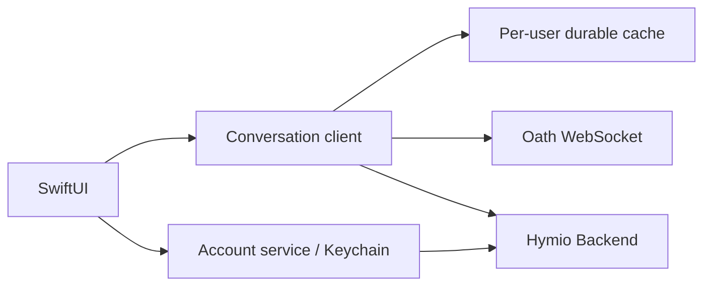

# 14 — iOS MVP

## 总览

原生 SwiftUI 客户端位于 apps/ios，连接同一 Hymio Backend 与 Oath v2 协议。
一个账号只有一段持续对话。首版提供账号登录注册、流式文字、工具明细与授权、
鉴权截图、历史分页、前后台恢复、账号设备管理与按需诊断。Kit 从独立“应用”入口加载真实 Web
bundle，并通过原生桥访问同一业务 API；应用内有 coding conversation 和版本记录。账号由页顶
伴侣头像进入，不再占用底部页签。

## 连接与持久化

后端地址由构建配置指定，Release 仅接受 HTTPS/WSS；Debug 允许本机网络。
首版使用现有 account 登录模式，凭据只存 Keychain。刷新串行执行，失败不清除未确认命令。
客户端只提交凭据与服务端签发的 user_id，不创建用户或会话。

每个账号独立保存事件、checkpoint、历史页游标和待确认命令；文件原子写入并启用系统文件保护。
快照持久化后才 ACK，增量事件连续确认；重复事件忽略，缺口重新 attach 获取快照。
命令先落盘再发送，重连保持原 command id；ACK 后删除。退出账号清除本机对应缓存。
前台运行连接与心跳，后台断开连接，不取消服务端任务；回前台刷新凭据并重连。
首版不保证后台持续收消息，也不提供 APNs；恢复依靠离线补发。

## 展示与交互

白底、深墨色与少量蓝色。品牌角色使用静态状态图，不运行呼吸或逐帧动画。
对话、工具、授权共用同一内容列；输入框在安全区内跟随键盘，允许 Agent 工作时追加输入。
流式回复合并到 step；attempt 增大清空旧增量，终态替换增量。
历史前插不推进实时 checkpoint。用户正在阅读旧记录时不因新 token 强制滚动。
截图使用受保护媒体路径，经当前账号鉴权读取；不将 Bearer 发到其他域名。
设备页展示真实在线状态，确保电脑逻辑复用 Backend；iPhone 自身只有对话能力。

附件选择不把 PhotosPicker 嵌入菜单；照片图库使用独立系统 picker。图像在后台线程
下采样到最长边 2048 px 后上传，上传结果按 attachment URL 进入有界内存缓存，tray 和对话
缩略图直接解码缓存字节。图片/文件合计每条消息最多 12 个。

探索记录首屏只请求 30 条，更多记录显式加载。Trace 详情先请求 summary，只返回节点和事件
名称；完整模型事件按需加载。通用 JSON 解码与图片解码不占用 MainActor，避免阻塞滚动和
导航。

## 发布与边界

共享 Xcode scheme，Debug 连本机服务，Release 必须配置部署域名、开发团队及 Bundle ID。
提供模拟器构建运行脚本；TestFlight 需要开发者签名与 App Store Connect 配置。
日志和诊断不显示凭据。网络失败显示可重试状态；存储失败停止 ACK，不能假装消息已保存。

## 视觉与动效

视觉规则与官方参考见 [apps/ios/DESIGN.md](../apps/ios/DESIGN.md)。输入框在 iOS 26 使用
原生 Liquid Glass，旧系统与减少透明度回退到实色；消息本身保持不透明阅读面。
角色只切换静态状态图，不运行常驻动画。账号页以原生 zoom 从头像展开。
新增消息仅按消息数量触发一次短动画，不逐 token 动画。助手可对用户消息留下单向表情，
表情贴纸位于用户气泡边缘，用户没有发表情入口。

## Markdown

原生 MarkdownUI 固定为 2.4.1，并提交 Swift Package 锁文件。支持 CommonMark / GFM 的
标题、强调、嵌套列表、任务列表、引用、表格、链接与代码块；宽表格和代码横向滚动，代码可复制。
块级和行内图片都由应用提供加载实现，截图沿用账号鉴权；外部 HTTPS 图片不附带 Bearer，
拒绝重定向。链接仅允许 HTTP、HTTPS 和 mailto，不执行 HTML 或任意 URL scheme。
