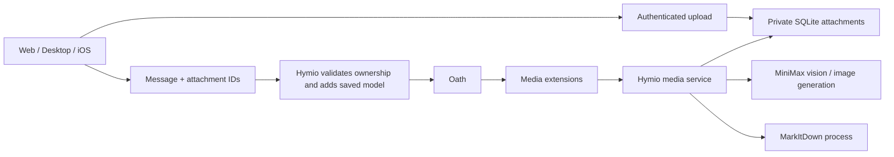

# Models and media

Status: Implemented

## Overview

Hymio keeps one conversation and lets each user select its model, upload private attachments, understand images and documents, and create images. Oath remains provider-neutral; Hymio owns uploads and media extensions.

## Model selection

`model_options` is the deployer's allowlist, ordered with the default first. A persisted user preference is shared across clients. Backend injects the selection when forwarding a user message; clients cannot select credentials or endpoints. Oath independently restricts IDs with `agent.selectable_models`, freezes the model in each step, and preserves it for tool continuations and recovery. Choices may use independent Oath `agent.model_providers` entries. Each entry selects its endpoint, model ID, parameters and Vault alias. Media APIs continue to use their separately configured provider.

## Attachments

Upload is a bounded raw body with an encoded filename header, not a base64 WebSocket frame. Up to eight references travel with a message. Each original file is limited to 20 MiB, with a 256 MiB account quota. Metadata and bytes live together in SQLite under the authenticated user. Image normalization strips metadata and limits resolution. Reading an attachment always checks ownership; UUIDs are not authorization.

Web/Desktop accepts screenshot paste in the composer as well as file selection. iOS offers PhotosPicker, camera, Files and system image paste. Clipboard access occurs only during an explicit paste action; ordinary text paste remains unchanged. Upload progress is separate from message submission. Draft text remains editable while uploading; sending waits for completed uploads. Images render through the authenticated image loader, never bearer tokens in URLs.

Images and common PDF/Office/text documents are supported initially. Common audio files are transcribed through MiniMax ASR. Arbitrary archives, executables and video are rejected. `multimodal_understand` uses MiniMax M3 for images and MarkItDown for documents. Conversion runs in a disposable process with a fixed deadline, bounded archive expansion and bounded Markdown output. Document content is untrusted input. Empty extraction does not imply a scanned PDF was understood.

## Image creation

The `image-creation` Skill directs `image_generate`: text prompt, aspect ratio and optional owned character reference. MiniMax image-01 currently offers character-reference generation, not arbitrary pixel editing. Generated base64 output is normalized and saved as a private attachment; clients render its stable URL across devices.

## Credentials and failures

Media calls resolve the configured alias from Vault using private AppRole files. The local launcher derives alias, endpoint and Vault paths from Oath configuration; no API key is sent to clients, tools or Bash environments. Cloud deployers mount the same private identity files explicitly.

Each media invocation is recorded before calling a provider. Completed results are reusable; an interrupted call remains outcome_unknown and is never blindly repeated. An extension timeout does not imply a paid generation failed. Backend concurrency and request/convert deadlines are bounded. Account quotas fail closed; attachment deletion/retention and video ingestion remain follow-up work.
