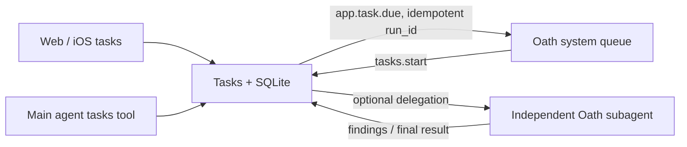

# Tasks and delegation

Status: Implemented

## Overview

Hymio gives its single personal agent a durable work list. Each task describes an outcome;
each run records one attempt, its findings and final result. Ordinary conversation is the primary
entry point; the model extracts accepted intentions, records intermediate outcomes and closes them.
Scheduling is an optional trigger and never creates another chat.
Oath owns bounded delegated execution; Hymio owns task business state and schedules.

## Task and run

Tasks are owned by user_id. They contain title, objective, success criteria, schedule and state.
Runs contain admission time, execution status, findings, final result and an optional agent_id.
Task states: active, paused, cancelled, archived. Run states: scheduled, delivering, ready,
running, blocked, succeeded, failed, cancelled, expired. No fabricated percentage represents progress.
A one-time task has one run; recurrence plans its next run after the active attempt terminates.

CRUD, start, progress, finish and delegate use the same owner-scoped service for clients and tools.
Start atomically checks task generation and status. Editing or pausing invalidates pending deliveries;
cancelling also terminates linked delegation. An already dispatched external action cannot be undone.
Completed one-time tasks can be run again explicitly. Findings and results remain visible.

## Capturing conversational work

`capture` records work already admitted by the current conversation. It creates a running run directly,
never a scheduled/delivering row or app.task.due event. An owner-scoped unique intent_key deduplicates
retries across tool invocations; it never reopens completed work. Distinct requested outcomes need
separate keys. Greetings and tentative ideas are not commitments. A quick result can be captured as
succeeded atomically, without an extra start/complete cycle. Only the agent's internal API accepts capture.

Task source is conversation/manual/scheduled. Runs separate phase, latest progress, next_step and final
result. Timeline updates carry their resulting status and phase; blockers remain visible until progress
resumes that same run. Changes are transactional; schema additions preserve existing records.
Lists return the latest 100 unarchived tasks; older records remain addressable by ID. The limit on
unfinished tasks is separate: completed records do not prevent accepting new work.
Recording an intention grants no extra execution or approval authority. Extraction is model-driven,
not guaranteed NLP classification; no hidden second model or extra per-message extraction request runs.

## Scheduling

An indexed due_at column is the persistent timer. A bounded service loop claims due runs with a lease,
checks current task generation, and submits app.task.due with run_id as the idempotency key.
No user threads or daily planner job are needed. Re-delivery after a crash uses the same event ID.
Schedules support immediate, a date/time, daily or weekly in an explicit IANA timezone.
A paused schedule does not dispatch. Overdue recurrence produces one catch-up run, never a burst.
After termination the next future occurrence is computed; overlapping runs of one task are prohibited.

The event instructs the main agent to call tasks.start before acting. Tools check admission again;
the runtime cannot retract arbitrary actions the model already dispatched before cancellation.
Scheduled work uses a short-lived Backend-signed credential, verified by the existing Oath remote-auth
contract. Credentials are never included in events, prompts, or client state.

## Delegated results

The task tool can attach a bounded Oath subagent to a running run. request_id=run_id prevents a
second child after transport uncertainty. A service loop mirrors findings and terminal status into
the task timeline, without model polling. Parent notifications still flow through Oath system events.
Children cannot create tasks or other children. A blocked attempt ends clearly rather than retrying forever.

## Clients

A task sheet sits alongside the single conversation: active work, upcoming dates, completed results.
Details emphasize the objective, current phase, next action, final result and chronological updates. Users can
create, edit, pause, cancel and inspect tasks. Web/Desktop and native iOS use the same authenticated API.
Task data refreshes while the panel is visible; no permanent chat reconnect is required.

## Failure and recovery

SQLite owns all transitions. Dispatch leases expire after interruption; delivery IDs stay stable.
Before start, generation/state checks reject a stale event even if it was already queued.
A lost delegation response is retried with the same run_id. Reconciliation survives Backend restart.
Temporary service errors retain pending work and retry with delay. All network operations are bounded.

## API and deployment

`GET /tasks` lists the owner's tasks. `POST /tasks` accepts action=list/get/capture/create/edit/delete/
pause/resume/cancel/start/progress/complete/fail/block/delegate. Target task_id or run_id is mandatory
for its corresponding action; notes use note_id for retry identity. The Agent's `tasks` extension
uses the same operations through `/internal/tasks`, authenticated with the existing Backend service key.
Clients never receive that key. Run statuses are distinct from the task's schedule state.

The scheduler starts in Backend's lifespan and shares its SQLite owner. No cron container, delay broker
or new deployment credential is needed. The existing Oath remote-auth setup verifies short-lived
Backend service deliveries; the same user_id owns the resulting system event. Use Oath with the
matching delegation/application-event contract. Old runtime binaries cannot serve this feature.

## Presentation

Completed turns keep all reasoning, including reasoning from the final step, inside the work disclosure. Only final answer content stays outside. This is a client projection: stored messages remain intact, streaming stays live, and reasoning-only endings do not create empty answer cards.

Chat work disclosures use a compact, bordered process region with distinct summary/body styles.
Reasoning uses the same plain disclosure row as tools, without a separate card or message metadata; details expand inline.
Assistant answers sit on a subtle adaptive surface; process rows avoid repeated nested answer cards.
Web Trace fills the available content width; JSON branches distinguish container depth and literal
value types without relying only on color. Reduced motion and native Dynamic Type remain supported.

## Reconciliation and conversation boundaries

Task kind is `task` or `reminder`. A reminder completes when its execution produces a durable final
reply, not when a phone acknowledges reading it. General work requires an explicit outcome; a final
reply without a task outcome is reconciled to blocked, never inferred as successful.

Each occurrence has a start deadline (`due_at + schedule.grace_seconds`, default 15 minutes).
Scheduled, delivering and ready occurrences outside that window become expired transactionally;
the next recurring occurrence is planned without replaying every missed occurrence. Start rechecks
the deadline. Active work has an inactivity limit (`schedule.run_timeout_seconds`, default one hour)
and becomes blocked if no progress is recorded. Expiry and missing closure produce durable,
idempotent system notices. Each run receives at most one automatic reconciliation intervention,
so missing model bookkeeping cannot create a wakeup loop. Later state changes remain visible in
the task panel. Reconciliation runs without an attached client and survives restarts.

A completed assistant answer closes its presentation segment even if later proactive execution
reuses the same trace ID. Replay boundaries are client-specific and display a divider for unread
assistant answers; they do not alter runtime trace identity. Failed local sends retain their original
chronological position and offer explicit retry/remove actions. Retry preserves the command ID and
payload, so an ambiguous network failure cannot duplicate an accepted user request.
