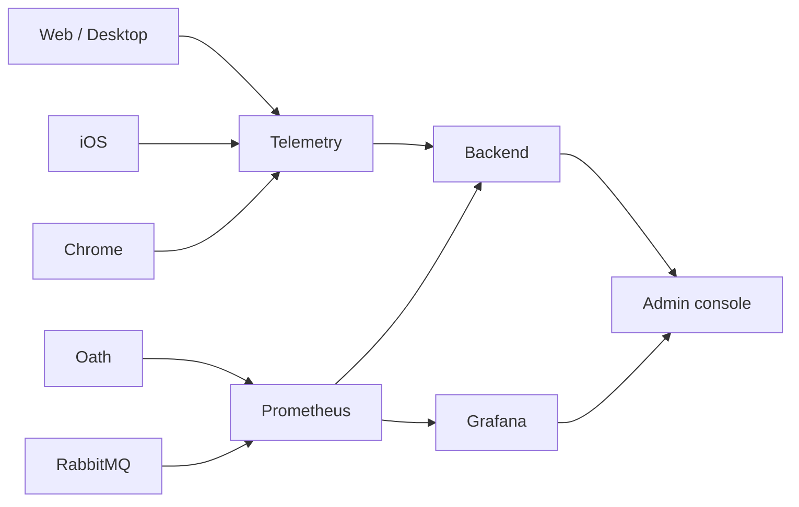

# Feature 28 — Observability and evaluation

状态：Implemented

## 总览

Hymio 管理台增加统一观测视图：Prometheus 保存运行指标，Grafana 提供标准开源仪表盘，
Hymio Backend 保存不含 prompt 的客户端端到端样本，并转发管理员对 Oath trace 的只读查询。



观测数据是派生数据。它不改变登录、消息接纳、ACK、持久事件或模型上下文。

## 客户端样本

每个用户 turn 产生一条幂等样本，至少包含：

- `channel`：`web`、`ios`、`desk`、`chrome` 或 `unknown`
- 匿名的 `client_id` / `device_id`
- `message_id` 与服务端关联得到的 `trace_id`
- 从点击发送到 server ACK、首增量、首个正文、首个可渲染正文、最终终态的耗时
- 已发送但 30 秒内没有任何模型增量的样本以 `outcome=stalled` 上报；它不是服务端终态
- 同一 trace 的 step 数、工具调用数、成功工具数、工具总耗时和模型调用数

指标表不上传正文、附件、模型输出或凭据。为支持按用户 query 定位问题，同一条幂等
样本中的用户消息正文和结构化生命周期事件会进入 Backend 的独立事件日志；该日志仅供
管理员授权查询，存在保留期和容量上限，不进入 Prometheus label。客户端不把绝对系统
时间当作可信单调时间：传输使用客户端发送起点，跨端比较优先使用服务端收到样本的时间
和 trace 时间。

用户消息的生命周期事件在 Web 客户端创建 command、更新本地会话后立即写入持久 outbox，
不等待本地命令存储、WebSocket flush 或服务端 ACK。这样即使后续链路完全卡住，管理员
仍能按 query 找到 `client.user.message` 样本。

发送失败、取消和部分流也必须反映在 outcome 中；不能只统计成功请求，否则端到端指标
会系统性偏乐观。

### 数学口径

设一次 turn 的客户端单调时钟起点为 `t0`，收到同一 `command_id` ACK 的时刻为
`t_ack`，首个任意 `assistant.delta` 为 `t_delta`，首个 `content` 增量、浏览器首帧和
终态分别为 `t_content`、`t_paint`、`t_terminal`。上报值均为累计时间，单位 ms：

```text
A = t_ack         - t0
R = t_delta       - t0
C = t_content     - t0
P = t_paint       - t0    # Web/Desktop；iOS 为 NULL
E = t_terminal    - t0    # 首个 completed/failed/cancelled step.status，或命令拒绝
```

客户端 p50/p95/p99 使用原始样本的线性插值：对升序样本 `x_1..x_n`，令
`h=(n-1)p`，则
`Q_p=x_floor(h)+(h-floor(h))*(x_ceil(h)-x_floor(h))`。各 stage 独立剔除 NULL，
窗口按 `received_at` 过滤并按该字段保留最新 5000 条幂等样本。

令终态集合 `T={completed, failed, cancelled, partial}`，`N_T` 为具备终态的样本数。
完成率和失败率分别使用 completed、failed 数除以 `N_T`；`N_T=0` 时无定义并显示 `—`。
只有 sent、accepted 或 in_progress 的请求不能解释为 0% 完成。无响应率仍使用窗口内
全部 turn 数 `N` 作为分母，因为 stalled 是客户端观察状态，不是服务端终态。

每个渠道同时返回 `turns / acknowledged / first_response / renderable / terminal / traced`
覆盖计数。管理台先显示数据覆盖，再显示有分母的比率；缺失阶段不填成 0 ms。

### 上下文整理

管理台把每次压缩视为独立 attempt，并按 `compression_id` 聚合 `started` 与
`ready / failed / skipped`。`applied` 表示同一份 ready 产物在后续 Brain 启动时生效，
不是新的 attempt。同步整理会阻塞当前回复；异步整理只准备后续模型视图，不阻塞唤醒。

Backend 优先通过 Oath 管理 API 读取持久 Outbox 中的压缩事件，因此用户离线时也能形成
运营数据；客户端在线事件作为向后兼容的补充来源。记录包含 mode、status、reason、
covers、context_window、估算 input/output、duration、trace/step 和 channel。事件正文、
对话原文和摘要正文不进入管理台。

成功产出率只在终态 attempts 上计算：

```text
A = N_ready / (N_ready + N_failed + N_skipped)
```

`started` 不算成功或失败，缺失终态保持未知。Token 大小来自运行时字符估算，不是
provider usage，界面必须标为估算。lease_busy 表示压缩互斥被其他任务占用，不产生新的
模型调用。context_window 原因导致的 paused step 单独计入阻塞回复。Oath 指标不可用时
显示无数据，不显示成 0 成功。

### HTTP 接口

Hymio Backend 的 ASGI 中间件对每个完成的 HTTP 响应记录
`hymio_http_requests_total{method,route,status}` 和
`hymio_http_request_duration_seconds{method,route}`。`route` 使用路由模板，动态 ID 不进入
label；`/metrics` 自抓取不进入业务接口指标。耗时从请求进入开始，到最后一个响应 body
chunk 写完，因此包含 JSON 序列化、压缩和文件流。

接口成功率严格定义为 `S_r = sum[200 <= status < 300] / N_r`。管理台对每个 route 显示
请求速率、成功率、平均值和 P50/P90/P95；分位数用 5 分钟窗口的 histogram bucket 计算，
平均值用 `duration_sum / duration_count`，不把客户端端到端耗时混入服务端接口耗时。

Trace 派生量在样本上报时读取 span 快照：

- `step_count` 是 `name=invoke_agent` 且 `parent_span_id=NULL` 的 span 数。
- `model_calls` 是 `gen_ai.operation.name=chat` 的 span 数。
- `tool_calls` 是名称以 `execute_tool ` 开头的 span 数。
- `tool_successes` 是上述工具 span 中 `oath.tool.outcome=succeeded` 的数量。
- 工具成功率为 `sum(tool_successes)/sum(tool_calls)`；分母为 0 时无定义。
- `tool_ms` 是单 trace 所有工具 span duration 的和；渠道均值先按 trace 求和再平均。

Trace 查询失败时派生字段为 NULL，不按 0 处理，也不进入对应均值或比率。

## 管理台

Trace 列表优先显示用户消息或唤醒事件摘要，来自持久生命周期事件和 OTel 输入事件，
不从完整模型 prompt 猜测用户意图。摘要按用户和 message/trace ID 读取；详情保留多个
独立输入，并按 parent span 展示执行层级。缺失客户端终态耗时保持未知，链路跨度单独标注。

日志中心在无搜索词时读取对应来源的最近事件，搜索支持消息正文与系统唤醒。
Prometheus 按指标记录查询失败；单个指标失败不隐藏其余可用数据。
HTTP 区分数据源不可用和当前窗口缺少请求，不以空白或 0 ms 代替错误。

管理台使用四个独立子页面：

- 概览：全局 KPI、服务端指标、按 web、iOS、desk、chrome 分组的客户端体验。
- Trace 排查：查询与筛选 trace，左侧结果表、右侧 span 瀑布和 OTel attributes/events。
- 日志中心：按 trace_id 汇总 Span events，可按事件名、节点和 attributes 过滤；与
  Trace 使用相同的选择上下文。
- 排查手册：无回复问题的状态闸门、判定表与人工检查清单。

无响应样本必须在 30 秒观察窗结束后上报，即使没有服务端终态；否则“已送达但没有回复”
这一类最需要排查的问题不会进入管理台。

界面结构参考成熟可观测产品：

- [Grafana Explore](https://grafana.com/docs/grafana/latest/visualizations/explore/)：查询、
  日志和 trace 使用稳定的时间范围与查询上下文。
- [Honeycomb Query Builder](https://docs.honeycomb.io/investigate/query/build)：筛选、
  分组、时间范围与结果摘要保持在同一工作流。
- [Sentry Trace Explorer](https://docs.sentry.io/product/trace-explorer/)：筛选栏、趋势图和
  样本表并列，选中样本后进入详情。
- [Datadog Trace Explorer](https://docs.datadoghq.com/tracing/trace_explorer/) 与
  [Log Explorer](https://docs.datadoghq.com/logs/explorer/)：Trace 和 Log 是独立 Explorer，
  而不是同一个仪表盘里的装饰卡片。

因此 Hymio 管理台把总览、Trace 排查、日志中心和排查手册拆成独立路由；不使用没有证据的
“健康/需要关注”结论替代可核对字段。

日志中心使用 Backend 独立的 `observability.sqlite3`：结构化事件先幂等写入
`events(stage,message_id,trace_id,channel,occurred_at,source,body)`，同时写入 SQLite FTS5
索引；Trace 到达后再按 `trace_id` 增量补齐 span 和 span event。查询时直接走 FTS5
倒排索引，不遍历最近 turn，也不对每条历史日志做字符串扫描。中文文本按 Unicode
字符切分后使用 FTS5 phrase 查询，因此短关键词不依赖前缀偶然匹配。

客户端生命周期、Gateway、Queue、Consumer、Worker、模型、工具和 Delivery 事件使用同一
`message_id` / `trace_id` 关联。日志结果按 `occurred_at` 倒序返回命中的事件，再附带
`user_id`、`user_name`、channel、node 和 span attributes。关键词和原始事件片段只在
管理员鉴权后返回，不进入 Prometheus label。

事件日志默认保留 7 天，最多 20000 条，写入时按时间和总条数裁剪，避免字符串匹配导致
全表扫描，也避免监控自身无界增长。若关键词没有命中，界面区分“事件日志尚无该 query”
与“已有 `message_id` 但尚未形成 trace”，不能把空结果解释为服务端没有执行。

日志中心默认只检索 `source=application` 的客户端、Gateway、队列和业务生命周期日志；
`source=otel` 的 Span 事件作为独立来源切换查看。Trace 页中的“链路事件”只属于当前
trace 的 Span events 与生命周期，不是日志中心的另一份副本。Gateway 收到 ACK 时必须
把 ACK 中的 `trace_id` 写入事件列并建立索引任务；旧 ACK 只在缺少关联时做一次幂等修复。

管理台的“日志中心”明确区分三种来源：

- 生命周期事件：结构化 command、ACK、队列与 step 状态，用于按 `message_id` 聚合。
- OTel 事件：span 及其 attributes/events，用于链路解释。
- 系统日志：Python `logging` 实际输出的 `service / level / logger / message / trace_id`
  记录，独立写入 `system_logs` 与 FTS5 索引，不与生命周期事件共用一份数据。

Backend 在 lifespan 内安装异步 `QueueHandler`，日志写入不阻塞请求；`/internal/logs`
仅为持有内部服务凭据的进程提供结构化摄入。内置 logger 不记录凭据，Bearer 文本在落库前
再次脱敏。日志中心不再把 lifecycle event 标成“应用日志”，也不会把同一行同时显示为
OTel 事件和系统日志。

管理 API 只允许配置的 admin 用户。跨用户 trace 查询由 Backend 使用内部服务凭据调用
Oath Biz；浏览器不接触 Oath 服务凭据。

移动端 Trace 详情先请求 `query_trace?summary=1`。摘要保留节点、父子关系、状态、耗时、
attributes 和事件名称，但不传模型请求/响应等 event attributes 正文；用户选择查看原始
数据时再请求 full trace。这样首屏不需要下载和解码大段模型输入输出。

## 部署

Prometheus、Grafana 与 RabbitMQ Prometheus endpoint 由部署组合启动。Grafana 数据源和
基础 dashboard 使用版本化配置文件，不把管理员密码、模型 key 或生产 trace 写入仓库。
本地默认 loopback 绑定；云端只允许 Backend 私网访问 Prometheus，Grafana 不直接公开。

## 失败与恢复

- Prometheus/Grafana 不可用：管理台其余功能正常，观测区显示不可用状态。
- telemetry 写入失败：不影响客户端连接和消息执行，客户端不进入重试风暴。
- trace 不可查：样本仍保留客户端 timing，trace 统计字段显示未知。
- 同一 message 重复上报：按用户和 `message_id` 幂等覆盖，不重复计数。
