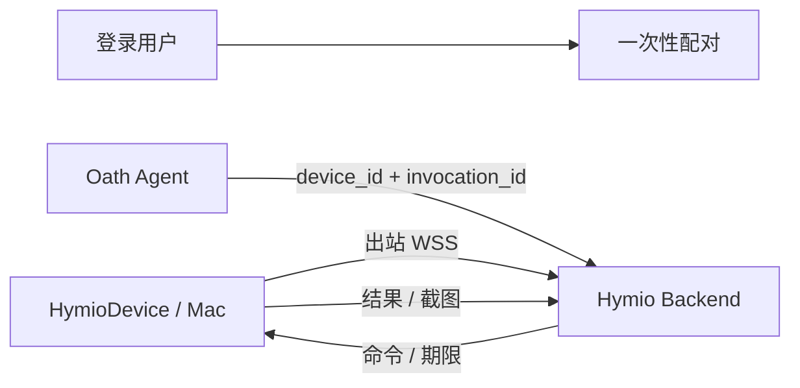

# Personal device Link

状态：Implemented

## 总览

HymioDevice 是独立设备代理仓库。个人 Mac 主动连接 Backend 的 WSS Link API，Backend
将现有 `computer` / `browser` / `bash` invocation 发给该设备。家庭网络无需开放入站端口。
账号、设备归属、命令记录和截图访问权限属于 Hymio；代理只持有自己的设备凭证。

## 配对与生命周期

`POST /devices/link/pairings` 使用用户凭证，返回五分钟有效的随机配对码。
`POST /devices/link/claim` 消费该码，创建 `personal_mac` / `link` 设备和独立设备凭证。
每个账号至多绑定一台 personal Mac；与 Mac 对话客户端的 channel 绑定分开。
Web 和 iOS 账号页都可生成配对码、暂停/恢复连接并解除绑定；配对码不进入消息历史。
凭证保存在 macOS Keychain，Backend 只保存摘要，九十天到期后重新配对。
用户可暂停、继续或解除绑定。解除不关机、不删除本机文件，立即阻止后续调度。
暂停/撤销不声称能回滚已开始的点击或命令。本机菜单可断开代理，Shell 默认关闭。

## 传输

`/devices/link/ws` 首帧 `link.attach` 包含设备凭证；禁止 query token。
服务端回复 `link.ready`；双方每十五秒交换 `link.ping` / `link.pong`，服务端验证
凭证和设备状态，三十秒无输入断开。新连接替换旧连接，旧连接不能完成新连接的请求。
协议 v1，命令 `link.command` 含 device_id、generation、invocation_id、expires_at、
capability、arguments，以及可选的 parent_invocation_id 和 execution_environment。
短期 CLI capability 只在执行环境中传输，不写入本地 journal。结果 `link.result` 含
invocation_id、generation、payload。
代理串行执行，使用本地 journal 在副作用之前记录 running，再保存终态后回传。
attach 与每次 ping 可携带 capabilities 和 permissions；Backend 即时更新设备声明，
权限变更不要求重新配对。旧代理未报告具体权限时保留空 permissions，不推断已获授权。

## 执行与恢复

沿用 DeviceStore 的归属、fingerprint、设备锁和命令表；个人设备不占公有云名额。
Backend 仍为单实例；连接注册表仅在本进程持有，不支持多个 Backend 横向部署。
断线、进程退出或超时后，不重放有副作用的命令；保留 outcome_unknown 和设备锁。
代理重连后补报已保存结果，Backend 校验设备、generation 和 invocation 后恢复终态。
本地 running 记录在代理重启后作为 outcome_unknown 回传；操作者核对后才能释放锁。
未知命令、过期命令、能力不匹配和协议超限均拒绝，不能由模型绕过本地权限。

## macOS MVP 与边界

macOS 14+，原生菜单栏代理，ScreenCaptureKit 截取主显示器，CGEvent 发送鼠标键盘，
Accessibility 与 Screen Recording 由系统授权。截图固定为 1280×800 letterbox，点击
使用同一变换，黑边点击拒绝。只声明实际可用的能力；Shell 需本机显式开启。
同一本机开关启用 Bash 与 browser。browser 使用独立 Chromium profile，经仅监听 loopback
的 DevTools 提供 tabs、DOM snapshot、click、fill、key 与截图；不读取用户日常浏览 profile。
父 Bash 执行期间允许一个同设备 browser / computer 子操作复用控制租约，其他操作仍串行。
Android 10+ 适配器在 HymioDevice 的 android/ 中实现，复用同一套 Link 传输。
claim 可选 kind=personal_android；省略仍为 personal_mac，兼容旧 macOS 客户端。
每个账号可独立绑定一台 Mac 和一台 Android；Android 不暴露 Bash。
MediaProjection 负责用户确认后的屏幕共享，AccessibilityService 负责点击、滑动、
输入和 back/home/recents。computer 新增 swipe(x,y,x2,y2,duration_ms)，仅 Android
目标支持；截图仍使用 1280×800 letterbox 坐标。type 替换聚焦输入框，拒绝密码框。
手机锁定或权限缺失时不提供 computer 能力；屏幕旋转需重启共享，不猜测旧坐标。
凭证由 Android Keystore 加密，SQLite 保存去重和未 ACK 结果；进程恢复不重放操作。
手机 UI、权限、生命周期和构建说明见 HymioDevice/android/README.md。

## 跨仓库影响

Hymio 新增 Link API、个人设备执行路径、Web/iOS 配对与生命周期入口和 CLI 能力指引；
HymioDevice 实现 v1 协议、Keychain、设备执行与本地 journal。Mac App 可以清除本地
配对并切换服务，但服务端绑定仍需在 Hymio 中解除。
