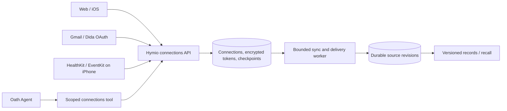

# Connections: cloud services and device sources

Status: Implemented foundation; provider credentials and physical-device authorization require deployment validation

Hymio owns authorization, collection and sync scheduling. Nostalgia stores source-versioned
context; Oath uses scoped Hymio tools and never receives provider credentials. Connector text
is untrusted evidence, not user instructions. Initial integrations collect data; they do not send
mail, edit external tasks, change calendars or write health samples.

## Lifecycle and ownership

Every connection belongs to the authenticated user. Registry entries declare transport, scopes,
platforms and read capabilities. OAuth service registrations are private deployment configuration;
missing registrations show an unavailable state rather than a broken authorization button.
Native sources bind to a specific installation and require separate permission and upload consent.
Web can inspect native-source status but never asks for unavailable browser permissions.

OAuth uses short-lived, single-use state bound to a connection and user; Gmail additionally uses
PKCE. Tokens are encrypted at rest using a persistent backend key, never returned to clients or
logged. Authentication failure requires reconnect; transient failure backs off. Disconnect stops
future collection and erases stored credentials; previously collected context remains explicit.

## Sync and durability

Cloud connectors use persisted due times, bounded pages and a fenced per-connection lease.
Restarted workers reclaim expired work. Fetches run outside SQLite transactions. Cursor advancement
and normalized revisions commit together; durable projection retries independently of collection.
Source identity includes connection and upstream identity. Content versions are deterministic;
replays reuse the same revision and Nostalgia operation identity. No cursor advances on failed fetch.
Nostalgia updates carry the previous acknowledged record identity, never blind-overwrite a 412.

Gmail starts with a bounded recent inbox and follows history pages. Expired history restarts that
bounded window, rather than downloading an entire mailbox. Dida polls bounded project/task pages;
absence in a partial response never means deletion. Calendar snapshots carry an explicit time
window and calendar selection; only complete window snapshots can reconcile removed occurrences.
Health records are daily aggregates, not raw clinical data. Native uploads are explicit foreground
sync in the first release; background delivery is a separate extension, not a real-time promise.

## Product surfaces

Connections live in account settings, with a catalog and connection detail: permissions, device,
coverage, last success, next action, imported count and recent runs. Distinguish never connected,
waiting for deployment setup, waiting for phone, collecting, ready, paused, retrying and reconnect.
Empty/error states never show fabricated data. Health upload explicitly explains server storage
and use by configured AI providers before the OS prompt; system permission alone is not consent.
Calendar requests EventKit full access because Apple provides no read-only grant, while Hymio
only reads selected calendars. No permission request occurs just by opening the catalog.

## Extension boundary

New providers implement registry metadata, OAuth/token lifecycle where relevant, bounded pull or
native push normalization, and checkpoint semantics. They reuse storage, jobs, UI states and context
projection. Future write actions need separate scopes, explicit intent and durable idempotency;
current connections do not imply permission to perform side effects. Cloud-phone/computer control
and connectors remain distinct capabilities.

## Deployment and validation boundaries

One optional private provider-registration file configures Gmail/Dida OAuth clients. The backend
creates its encryption key in the persistent data volume; back up this key with the database.
External apps require developer registration and user consent. Gmail restricted-scope verification
and Apple device HealthKit entitlement/permission cannot be replaced by mocked tests. Real provider
verification is reported separately from adapter tests and simulator UI validation.
