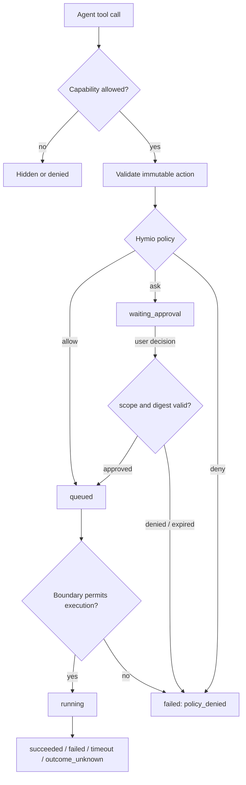

# Tool authorization and approvals

Status: Implemented

## Overview

Hymio must let an Agent act without asking about every safe operation, while retaining an
enforced boundary around credentials, devices, external side effects and irreversible actions.
The model can propose an action; it cannot grant itself access, approve its own request or
change the policy that judges it.

Authorization has four layers: capability determines whether a tool exists for this user,
channel and device; the execution boundary limits files, network destinations, applications,
accounts and time; approval decides whether one action needs a person; observation keeps
requested, decided, queued, running and terminal state queryable.



The rules that apply throughout this feature:

- **Approval is not a sandbox.** A person approving a command does not make unrestricted local
  access safe. Technical limits are enforced by the executor and operating system.
- **The model is not a policy authority.** Prompt text, retrieved pages, tool output and model
  reasoning cannot grant, widen or persist permission.
- **`deny` always wins over `ask`, which wins over `allow`.** Rule specificity cannot carve an
  exception out of a hard denial.
- **Approval binds one immutable action.** Target, normalized arguments, execution device,
  channel, run, policy version and action digest are checked again when the decision arrives.
- **Approval is not completion.** Approved, queued, running and succeeded are separate visible
  states.
- **Safe work stays low-friction.** Read-only and reversible operations inside an established
  boundary should not repeatedly interrupt the user.

## Industry baseline

Baseline reviewed 2026-10-28.

Official OpenAI Codex documentation treats sandboxing and approval as separate controls:
sandboxing defines the technical boundary, and approval decides when the Agent must stop before
crossing it. Its optional Auto-review only evaluates actions that already require approval; parse,
policy and reviewer failures fail closed. See [Agent approvals and
security](https://developers.openai.com/codex/agent-approvals-security) and
[Sandboxing](https://developers.openai.com/codex/sandboxing).

Claude Code uses tiered permissions and evaluates `deny`, then `ask`, then `allow`. Broader
approval scopes are offered only when the prompt can show everything they would cover. See
[Claude Code permissions](https://code.claude.com/docs/en/permissions).

Apple HIG requires permission requests to be specific and contextual, gives users control over
AI actions, and asks for confirmation before significant or irreversible actions. See
[Privacy](https://developer.apple.com/design/human-interface-guidelines/privacy#Requesting-permission)
and [Generative AI](https://developer.apple.com/design/human-interface-guidelines/generative-ai).

Hymio combines OpenAI's separation of technical boundary and approval, Claude Code's rule
precedence and exact scopes, and Apple's contextual plain-language consent.

## Product policy

Users choose one assistant mode:

| Mode | Default | Behavior |
| --- | --- | --- |
| Read-only | Research and review | Read operations inside granted sources; mutations and device control are denied until the user switches mode |
| Guided | Default | Safe reads and reversible internal writes run; shell, device control and external effects ask |
| Autonomous | Power use | Exact pre-approved rules and task grants run; unknown or high-risk actions still ask |

`Full local access` is not a normal assistant mode. It may exist only as a local development
setting on an explicitly selected device, with a warning that the Agent acts with the same file,
network and account access as that process.

The mode narrows or widens `allow` and `ask`. It never overrides a hard denial.

## Action classification

Risk belongs to the tool plus operation and target, not only to the tool name. For example,
`browser.snapshot` and `browser.fill` are different actions.

Every tool action declares:

```text
effect       read | write | delete | send | execute | spend | permission_change
resource     device | workspace | file | origin | account | task | app
scope        exact target, origin, path, account or device
reversibility reversible | recoverable | irreversible
sensitivity  public | personal | sensitive | critical
default      allow | ask | deny
grant        once | run | exact_rule
```

The server owns the action summary shown to the user. A model-generated rationale may accompany
the request, but it is never the source of truth for risk or scope.

### Allow

Automatic within the effective policy:

- Device discovery, task list/get, memory search/read and owned-media understanding; task progress,
  current-run capture, self-notifications, reactions and bounded internal writes.
- User-requested image generation within budget and browser reads inside a granted task/origin.

Automatic decisions still produce audit events. They are not silent.

### Ask

Require a person:

- Arbitrary Bash, including commands believed to be read-only unless they match an exact safe
  rule.
- Browser navigation to a new origin, clicking, filling, submission, upload, download, and
  desktop screenshots, clicks, typing, shortcuts or scrolling outside an existing task grant.
- Reading a new personal source such as mail, calendar, files or screen content.
- Writing, moving or deleting files outside the Agent workspace.
- Scheduling, delegation, cancellation, application publishing, mail/message sends, external
  calendar/task changes, software installation and downloaded scripts.
- Any operation whose actual effect cannot be classified with high confidence.

### Deny

Hard denial is an executable policy result, not a warning:

- Exporting passwords, private keys, cookies, OAuth credentials, Keychain items or session tokens.
- Modifying the Agent's own tool policy, grants or approval records, or using content, tool output
  or another Agent to authorize an action.
- Accessing another user, device, account or channel outside the current execution scope.
- Bypassing TCC, pairing, lock screen, administrator approval or audit; privilege escalation,
  process injection, security-setting changes and disabling safeguards.
- Financial transfers, payments or purchases.
- Recursive deletion of home/root/system directories; unverified code execution; arbitrary
  private/loopback access without an explicit target grant.

There is no `Allow once` button for a hard denial. The model receives a stable policy reason and
must stop, not search for a workaround through Bash, CLI, Browser or a subagent.

Subagents cannot create human approval requests in v1. An `ask` decision for a subagent is denied,
and safe read-only alternatives remain available.

## Scopes and grants

The default is `Allow once`. Other scopes appear only when the server can enumerate their full
effect. **This task** binds the exact action class, device, origin/account/path and expiry to the
run. **Exact rule** is server-generated, such as
`device:<id>/browser:origin:example.com/read` or `workspace:<id>/shell:git-status`.

There is no “allow all shell”, “allow all sites” or broad wildcard grant. A task grant cannot
cover submission, upload, purchase, deletion or another high-risk class unless those actions are
listed separately in the approval.

Persistent grants are user-owned records with creator, channel, device, creation time, expiry,
last use and revocation. A grant affects future calls only. Revoking it does not claim to undo a
side effect already in progress.

## Decision semantics

The policy engine evaluates authentication and ownership, channel/delegation/device capability,
schema and action digest, hard denials, user deny rules, user ask rules and scope, exact grants,
then the action default for the assistant mode. Rule specificity never changes this order.

Policy output is `allow`, `ask` or `deny` with a stable reason code. `ask` also returns the approval
view model. Policy errors do not become `allow`: interactive requests may become an approval,
while unattended execution fails closed.

An approval request contains `approval_id`, `invocation_id`, `action_digest`, `title`, `summary`,
`risk`, `effects[]`, target `{kind,id,label}`, `scope_options[]`, `expires_at`, `policy_reason`
and redacted details. A decision contains `approval_id`, `decision`, `scope`, `client_id`,
`channel`, `decided_at` and `reason`.

`action_digest` covers the user, run, tool, normalized arguments, target, device, policy version
and approval options. A changed action produces a new request. The first valid decision wins;
duplicate and concurrent decisions are idempotent and return the stored result.

## State and synchronization

```text
admitting
  -> waiting_approval
       -> approved -> queued -> running
       -> denied
       -> expired
       -> superseded
admitting -> queued -> running
  -> succeeded | failed | timeout | cancelled | outcome_unknown
```

`approved` means execution permission was granted, not that the action ran. `denied` and
`expired` are distinct from an execution failure. `superseded` is used when revocation, a changed
policy or a cancelled run invalidates a pending request before execution.

`permission.requested` carries the approval view model. `permission.resolved` carries the decision
metadata. `session.status` exposes pending and recently resolved approvals so a reconnecting
client does not depend on receiving one online event. Any signed-in client for the same user may
decide, but the card identifies the requesting client and the execution target.

Concurrent decisions use the existing transaction and command identity mechanism. A losing
client receives the winning decision and updates its card instead of showing a second outcome.

## Client experience

Approvals appear inline with the tool activity they govern. A separate global list is useful for
recovery, but it is not the primary interaction.

```text
┌ Allow Hymio to run this command on Mac mini?           High
│ Read the current project and run the test suite.
│
│ Target   Mac mini · personal device
│ Effect   Read project files; execute npm test
│ Scope    This task
│ Expires  in 5 minutes
│
│ [Show details]
│
│ Decline                                      Allow once  v
└
```

The collapsed card shows the plain-language action, target, effect and expiry. Raw arguments are
available through progressive disclosure and are redacted before display. The primary action is
`Allow once`; narrower or broader scope choices live in a menu only when valid.

For destructive or irreversible actions, opening the card presents a focused sheet with the exact
target, affected item count when known, reversibility and the safe alternative. It never defaults
focus to the confirmation button and does not approve on Return.

Visible states include `Waiting for approval`, `Submitting`, `Allowed on iPhone`, `Allowed,
waiting to run`, `Running`, `Declined, not run`, `Expired, not run` and `Superseded`.

Interaction requirements:

- Use text and icon in addition to color; support Dynamic Type, keyboard, VoiceOver and reduced
  motion. Mobile controls have at least a 44×44 pt hit region.
- Use one inline request per action and a focused sheet only for high-risk detail. Never show
  multiple blocking alerts, auto-focus approval or visually over-emphasize it.
- Allow an optional denial reason; denial means the Agent stops that route. Keep resolved
  approvals as history, not active questions.

The user permission center lists assistant mode, device capabilities, standing grants and recent
decisions. Users can revoke a grant, but cannot edit the hard-denial policy from the model
conversation. HymioDevice's local Shell/Screen Recording/Accessibility switches remain separate:
they expose a capability, while Hymio approval authorizes a concrete action.

## Ownership and cross-repository contract

Hymio owns user intent, risk classification, approval presentation, persistent grants and product
policy. Oath owns capability filtering, immutable invocation state, approval lifecycle, TTL,
idempotent decisions, queueing and terminal events. Oath core must not learn Hymio tool names or
business semantics.

Oath's `PermissionPolicy` returns a structured decision. The Tools service stores the decision
and approval view in `call.permission`; Hymio Backend evaluates policy through its service
credential. Clients never supply a verdict, risk level, policy rule or authorization identity.

This is a breaking protocol change. Oath, Hymio Backend, Web and iOS update together; no
compatibility path is retained.

## Failure and recovery

- Policy timeout never allows automatically: interactive calls become `waiting_approval`, while
  background calls fail with `policy_unavailable`.
- Expiry, cancellation, revocation, policy change or digest change invalidates approval before
  execution. A late decision is rejected as already resolved.
- Event loss and backend restart reconstruct pending/resolved approvals and grants from persistent
  state without creating another invocation.
- Device or network failure after execution starts preserves `outcome_unknown`; approval never
  authorizes repeating the side effect.

## Non-goals and later work

Approval UI does not replace a sandbox. A personal Mac running Bash as the user's logged-in account
can reach anything that account can reach; product copy must say so. The long-term safe target is
a dedicated Agent account, container/VM or OS-enforced workspace with explicit file and network
grants.

Automatic reviewer models are deferred until deterministic policy, action metadata and audit are
stable. If added, a reviewer only evaluates eligible `ask` requests, sees the exact action and
compact evidence, can downgrade low/medium risk but cannot override hard denials, and fails closed
on timeout or parse errors. Repeated denials must trip a circuit breaker instead of encouraging
the Agent to try alternative routes.
