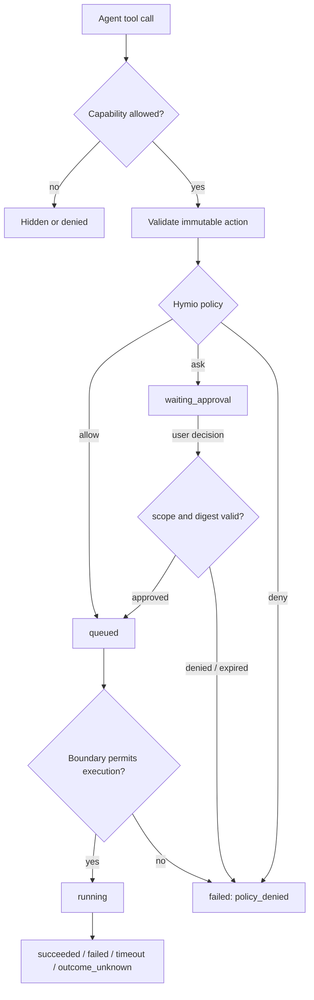

# Tool authorization and approvals

Status: Implemented

## Overview

Hymio must let an Agent act without asking about every safe operation, while retaining an
enforced boundary around credentials, devices, external side effects and irreversible actions.
The model can propose an action; it cannot grant itself access, approve its own request or
change the policy that judges it.

Authorization has four layers: capability determines whether a tool exists for this user,
channel and device; the execution boundary limits files, network destinations, applications,
accounts and time; approval decides whether one action needs a person; observation keeps
requested, decided, queued, running and terminal state queryable.



The rules that apply throughout this feature:

- **Approval is not a sandbox.** A person approving a command does not make unrestricted local
  access safe. Technical limits are enforced by the executor and operating system.
- **The model is not a policy authority.** Prompt text, retrieved pages, tool output and model
  reasoning cannot grant, widen or persist permission.
- **`deny` always wins over `ask`, which wins over `allow`.** Rule specificity cannot carve an
  exception out of a hard denial.
- **Approval binds one immutable action.** Target, normalized arguments, execution device,
  channel, run, policy version and action digest are checked again when the decision arrives.
- **Approval is not completion.** Approved, queued, running and succeeded are separate visible
  states.
- **Safe work stays low-friction.** Read-only and reversible operations inside an established
  boundary should not repeatedly interrupt the user.

## Industry baseline

Baseline reviewed 2026-10-28.

Official OpenAI Codex documentation treats sandboxing and approval as separate controls:
sandboxing defines the technical boundary, and approval decides when the Agent must stop before
crossing it. Its optional Auto-review only evaluates actions that already require approval; parse,
policy and reviewer failures fail closed. See [Agent approvals and
security](https://developers.openai.com/codex/agent-approvals-security) and
[Sandboxing](https://developers.openai.com/codex/sandboxing).

Claude Code uses tiered permissions and evaluates `deny`, then `ask`, then `allow`. Broader
approval scopes are offered only when the prompt can show everything they would cover. See
[Claude Code permissions](https://code.claude.com/docs/en/permissions).

Meta Muse keeps standard browsing uninterrupted and stops for consequential actions such as
purchases or sending mail. Its deterministic card previews the target and effect before presenting
clear accept/reject actions. Grok Bot's Auto Review lets most actions run and offers `Allow once`,
`Always allow` and `Deny`; narrow Auto-review rules are editable and Ask-first wins over Allow.
Manus-style long-running agents pair checkpoints with a live activity trail and a persistent
needs-input state. Sources reviewed 2026-10-28:
[Muse design](https://introducing.muse.ai/),
[Grok Bot approvals](https://docs.x.ai/grok-bot/approvals-security-and-privacy), and
[agent UI patterns](https://www.setproduct.com/blog/ai-agent-ui-design-patterns).

Apple HIG requires permission requests to be specific and contextual, gives users control over
AI actions, and asks for confirmation before significant or irreversible actions. See
[Privacy](https://developer.apple.com/design/human-interface-guidelines/privacy#Requesting-permission)
and [Generative AI](https://developer.apple.com/design/human-interface-guidelines/generative-ai).

Hymio combines OpenAI's separation of technical boundary and approval, Claude Code's rule
precedence and exact scopes, Muse/Grok's proportional interruption, and Apple's contextual
plain-language consent. Approval fatigue is a safety failure: if every command asks, people learn
to approve without reading.

## Product policy

Users choose one assistant mode:

| Mode | Default | Behavior |
| --- | --- | --- |
| Read-only | Research and review | Reads, inspection, screenshots and safe test/report commands run; mutations and device control are denied |
| Guided | Default | Reads run; mutations ask once per exact action or task, with an optional exact-rule whitelist |
| Fully Accessible (`autonomous`) | Power use | Ordinary read/write actions run; payment, credentials, security settings, irreversible deletion and external mutation still ask or deny |

The mode narrows or widens `allow` and `ask`. It never overrides a hard denial.
`Fully Accessible` is still subject to the executor boundary and always-confirm tier.

## Action classification

Risk belongs to the tool plus operation and target, not only to the tool name. For example,
`browser.snapshot` and `browser.fill` are different actions.

Every tool action declares:

```text
effect       read | write | delete | send | execute | spend | permission_change
resource     device | workspace | file | origin | account | task | app
scope        exact target, origin, path, account or device
reversibility reversible | recoverable | irreversible
sensitivity  public | personal | sensitive | critical
default      allow | ask | deny
grant        once | run | exact_rule
```

The server owns the action summary shown to the user. A model-generated rationale may accompany
the request, but it is never the source of truth for risk or scope.

### Allow

Automatic within the effective policy:

- Device discovery, task list/get, memory search/read and owned-media understanding; task progress,
  current-run capture, self-notifications, reactions and bounded internal writes.
- User-requested image generation within budget, desktop screenshots, application reads and
  bounded browser reads or navigation.
- Shell reads parsed without redirection, command substitution or mutation flags, including common
  workspace inspection, `git status`/`diff`/`log`, and known test, lint-without-fix, type-check and
  read-only build-check commands.

Automatic decisions still produce audit events. They are not silent.

### Ask

Require a person:

- Bash that writes, installs, generates artifacts or cannot be parsed as a bounded read.
- Browser clicking, filling, downloading or changing page state; desktop clicks, typing,
  shortcuts or scrolling outside an existing task grant.
- Writing, moving or deleting files outside the Agent workspace.
- Scheduling, delegation, cancellation, application publishing, mail/message sends, external
  calendar/task changes, software installation and downloaded scripts.
- Any operation whose actual effect cannot be classified with high confidence.

### Deny

Hard denial is an executable policy result, not a warning:

- Exporting passwords, private keys, cookies, OAuth credentials, Keychain items or session tokens.
- Modifying the Agent's own tool policy, grants or approval records, or using content, tool output
  or another Agent to authorize an action.
- Accessing another user, device, account or channel outside the current execution scope.
- Bypassing TCC, pairing, lock screen, administrator approval or audit; privilege escalation,
  process injection, security-setting changes and disabling safeguards.
- Recursive deletion of home/root/system directories; unverified code execution; arbitrary
  private/loopback access without an explicit target grant.
- Exporting credentials or bypassing platform authentication for a payment, transfer, purchase or
  other financial action.

There is no `Allow once` button for a hard denial. The model receives a stable policy reason and
must stop, not search for a workaround through Bash, CLI, Browser or a subagent.

Subagents cannot create human approval requests in v1. An `ask` decision for a subagent is denied,
and safe read-only alternatives remain available.

Non-read shell commands in guided mode ask once per exact command. Choosing `run` grants that exact
action until the current Oath `run_id` ends; a new user message normally starts a new run. Choosing
`exact_rule` adds a durable whitelist entry for the same tool, action and target, which can be
reviewed or revoked in Settings.

Critical actions ask on every use and do not offer a task, exact-rule or full-access bypass.
Examples include payment or purchase submission, sending or publishing externally, deleting
irreversible data, changing permissions, credentials or security settings, forced pushes and
remote release operations. Network mutations such as an authenticated HTTP POST, upload,
remote shell and package publication are also critical even in Fully Accessible mode.

## Scopes and grants

The UI exposes `Only this time`, **For this task**, and **Always allow** where safe. “For this
task” binds the exact action class, device, origin/account/path and expiry to the current Oath
run. A new user request normally starts a new run. “Always allow” stores one narrow rule for the
same tool, action and target and exposes it under Settings → Tool authorization for revocation.
Bash rules bind the complete command text rather than only its first line. Rule titles, summaries
and targets are derived by the server from the stored action; a client cannot put misleading
display copy on a whitelist entry.

There is no “allow all shell”, “allow all sites” or broad wildcard grant. A task grant cannot
cover submission, upload, purchase, deletion or another high-risk class unless those actions are
listed separately in the approval.

Guided mode stores at most 100 exact rules per user. Reaching the limit rejects a new rule rather
than silently evicting one the user chose. Revocation takes effect before the next policy check;
there is no separate in-memory wildcard to expire.

Run grants are persisted with creator, channel, device and expiry. A grant affects future calls
only and does not claim to undo a side effect already in progress.

## Decision semantics

The policy engine evaluates authentication and ownership, channel/delegation/device capability,
schema and action digest, hard denials, user deny rules, user ask rules and scope, exact grants,
then the action default for the assistant mode. Rule specificity never changes this order.

Policy output is `allow`, `ask` or `deny` with a stable reason code. `ask` also returns the approval
view model. Policy errors do not become `allow`: interactive requests may become an approval,
while unattended execution fails closed.

An approval request contains `approval_id`, `invocation_id`, `action_digest`, `title`, `summary`,
`risk`, `effects[]`, target `{kind,id,label}`, `scope_options[]`, `expires_at`, `policy_reason`
and redacted details. A decision contains `approval_id`, `decision`, `scope`, `client_id`,
`channel`, `decided_at` and `reason`.

`action_digest` covers the user, run, tool, normalized arguments, target, device, policy version
and approval options. A changed action produces a new request. The first valid decision wins;
duplicate and concurrent decisions are idempotent and return the stored result.

## State and synchronization

```text
admitting
  -> waiting_approval
       -> approved -> queued -> running
       -> denied
       -> expired
       -> superseded
admitting -> queued -> running
  -> succeeded | failed | timeout | cancelled | outcome_unknown
```

`approved` means execution permission was granted, not that the action ran. `denied` and
`expired` are distinct from an execution failure. `superseded` is used when revocation, a changed
policy or a cancelled run invalidates a pending request before execution.

Approval expiry is a terminal `permission_expired` result with `executed=false`; it is never
`outcome_unknown`. The Agent receives that terminal through the tool queue and may continue
without waiting for the user indefinitely. A decision received after expiry is a late decision:
the original call remains expired, a `permission.late_resolved` event is delivered to the Agent,
and an approved late decision creates a one-use retry credit for the exact action and run. The
Agent decides whether to create a new invocation; the tool system never revives the old one.

`permission.requested` carries the approval view model. `permission.resolved` carries the decision
metadata. `session.status` exposes pending and recently resolved approvals so a reconnecting
client does not depend on receiving one online event. Any signed-in client for the same user may
decide, but the card identifies the requesting client and the execution target.

Concurrent decisions use the existing transaction and command identity mechanism. A losing
client receives the winning decision and updates its card instead of showing a second outcome.

## Client experience

Approvals appear inline with the tool activity they govern. When one is waiting on another tab or
outside the visible transcript, a compact live reminder opens the conversation. In the iOS
conversation, a `Needs confirmation` pill replaces the scroll-to-latest control when the user has
scrolled away from a pending request. The same waiting state participates in the existing Live
Activity and is visible from the Lock Screen or Dynamic Island. Its one-second client projection
stops advertising the request at expiry and changes the activity to `Approval expired`.

```text
Run the test suite
Read the current project and run its tests.
Mac mini · Read files, execute commands · Expires in 5 min

Operation details
                                  Decline   For this task v   Allow
```

The approval surface uses the same text column and baseline as the assistant response. Its icon,
heading, effect copy, command/target preview, metadata and actions share one leading edge. A
single hairline surface replaces nested grey boxes. It has one heading, one sentence of effect
copy, a one-line command/target preview, compact metadata, progressive raw details, and one
primary action. Scope is a quiet adjacent menu only when more than one scope is valid. A critical
request has no menu and is labelled `Needs confirmation every time`.

Submitting a decision removes the active card immediately and shows a short acknowledgement while
the durable `permission.resolved` event travels. The acknowledgement is plain secondary text, not
a second card. If enqueueing fails, the original card returns with an error instead of leaving the
interface ambiguous.

Inline and assistant Markdown code use neutral surfaces, system monospaced type, a compact
language/copy toolbar, and a visible keyboard focus state. Inline code is visually distinct from
fenced blocks without using an accent color.

Bash calls include a `description` of at most 80 characters for display. Hymio policy normalizes it
and uses it as the approval title; native and device Bash schemas enforce the same limit. If it is
absent, clients use a stable tool label rather than exposing an internal name such as `cli`.

The inline card remains the default for destructive and irreversible actions. Raw arguments expand
in place. A separate sheet is reserved for cases where a complete affected-item list cannot fit;
it must show the exact target, reversibility and safe alternative, must not default focus to the
confirmation button and must not approve on Return.

Visible states include `Waiting for approval`, `Submitting`, `Allowed on iPhone`, `Allowed,
waiting to run`, `Running`, `Declined, not run`, `Expired, not run` and `Superseded`.

Interaction requirements:

- Use text and icon in addition to color; support Dynamic Type, keyboard, VoiceOver and reduced
  motion. Mobile controls have at least a 44×44 pt hit region.
- Use one inline request per action and a focused sheet only for high-risk detail. Never show
  multiple blocking alerts, auto-focus approval or visually over-emphasize it.
- Allow an optional denial reason; denial means the Agent stops that route. Keep resolved
  approvals as history, not active questions.
- Hide the active approval surface at `expires_at` even if the resolution event is delayed. The
  tool activity then reports `Expired, not run`; clients never derive that the tool is still
  waiting from a stale pending card.

The user permission center lists assistant mode and device capabilities. Users cannot edit the
hard-denial policy from the model conversation. HymioDevice's local Shell/Screen Recording/
Accessibility switches remain separate: they expose a capability, while Hymio approval authorizes
a concrete action. Settings also lists the user's bounded always-allow rules and supports revoking
one rule without changing the assistant mode.

## Ownership and cross-repository contract

Hymio owns user intent, risk classification, approval presentation, persistent grants and product
policy. Oath owns capability filtering, immutable invocation state, approval lifecycle, TTL,
idempotent decisions, queueing and terminal events. Oath core must not learn Hymio tool names or
business semantics.

Oath's `PermissionPolicy` returns a structured decision. The Tools service stores the decision
and approval view in `call.permission`; Hymio Backend evaluates policy through its service
credential. Clients never supply a verdict, risk level, policy rule or authorization identity.

This is a breaking protocol change. Oath, Hymio Backend, Web and iOS update together; no
compatibility path is retained.

## Failure and recovery

- Policy timeout never allows automatically: interactive calls become `waiting_approval`, while
  background calls fail with `policy_unavailable`.
- Expiry, cancellation, revocation, policy change or digest change invalidates approval before
  execution. A late decision is rejected as already resolved.
- Event loss and backend restart reconstruct pending/resolved approvals and grants from persistent
  state without creating another invocation.
- Device or network failure after execution starts preserves `outcome_unknown`; approval never
  authorizes repeating the side effect.

## Non-goals and later work

Approval UI does not replace a sandbox. A personal Mac running Bash as the user's logged-in account
can reach anything that account can reach; product copy must say so. The long-term safe target is
a dedicated Agent account, container/VM or OS-enforced workspace with explicit file and network
grants.

Automatic reviewer models are deferred until deterministic policy, action metadata and audit are
stable. If added, a reviewer only evaluates eligible `ask` requests, sees the exact action and
compact evidence, can downgrade low/medium risk but cannot override hard denials, and fails closed
on timeout or parse errors. Repeated denials must trip a circuit breaker instead of encouraging
the Agent to try alternative routes.
