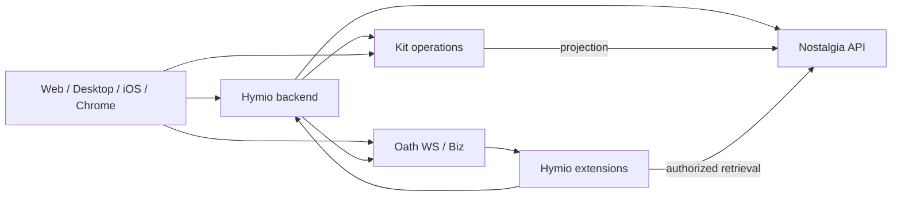

# Hymio 整体架构

Hymio 是统一应用层 monorepo：承载各端体验、共享 UI、产品后端、连接器、Kit、Oath 扩展与部署。Oath 负责 Agent 执行；Nostalgia 负责 personal context 的实体、存储和检索，两者独立维护。

当前提供 React/TypeScript/Vite + Tauri 2 客户端 MVP，直接接入已部署 Oath。产品后端已提供 OIDC 登录、应用凭证与 Oath 验证器，见 [feature08](feature08-login-auth.md)；Nostalgia 集成尚未实现，本机组合启动见 [feature09](feature09-local-start.md)，单机云部署见 [feature11](feature11-cloud-deployment.md)。详见 [feature07](feature07-client-mvp.md)。

## 产品边界

一个用户对应一段持续的 Agent 对话，不创建 session。客户端连接与执行生命周期分离；Oath 接纳的工作在用户断线后继续，重连按设备 cursor 接收持久事件。

设备绑定与投递 client_id 分开：每个窗口独立 ACK，不能用其他端的进度跳过消息。
Hymio 管设备归属、在线状态与执行命令；Oath 扩展显式指定 device_id。
云电脑统一 Bash / Chromium / 桌面操作，见 [feature10](feature10-multi-device.md)。

Context 的入口只有导入与同步：文字、语音、照片、文件和历史快照都属于一次性导入；绑定来源后持续获取变化属于同步。采集、连接器和媒体处理归 Hymio，Context 的规范与检索归 Nostalgia。

Kit 同时提供 Agent 可调用操作和用户体验。业务数据与约束归 Kit；Nostalgia 可保存其 context projection；Agent 和 UI 使用相同业务 API。

## 目录

```text
apps/client/       Web 前端 + Tauri 桌面壳
apps/chrome/       浏览器插件
apps/ios/          iOS 平台实现
packages/ui/       Web 共用组件、设计 tokens 和资源
packages/a2ui/     声明式 UI 渲染与用户动作
packages/protocol/ Hymio 契约与生成类型
packages/client/   HTTP/WS、认证接入、事件同步
backend/           账号、授权、连接器、导入同步、产品 API 与渠道适配
extensions/        Hymio 专属 Oath skill/tool/CLI
kits/              Kit 契约、业务能力与展示资源
deploy/            整套产品的依赖版本与部署组合
spec/              整体与 feature 设计
```

## 信息流



所有客户端连接都需要用户级认证；图中的直接连接是逻辑契约，公网代理、凭据签发与实际路由需在接入 feature 中确定。不能把 Oath 服务凭据发给客户端。

Web 与 Desktop 共用前端，Tauri 原生能力放平台适配层。Chrome 选择性复用 Web 包；iOS 共用协议、规范和资源，不假设 Web 组件能直接作为原生 UI。

共享包不反向依赖 apps。业务授权在后端/API 校验；连接器 token 不写进模型 context、trace、前端包或示例。

## 部署与演进

Hymio 的部署层组合 backend、Oath、Nostalgia，客户端只连接服务。Oath 的多个用户共用运行服务，不按用户创建整套部署。当前可独立使用 `oath start`；Hymio 的 `deploy/start.py` 提供本机开发组合入口，生产统一部署尚未实现。

应用模块先留在同仓库，按需独立构建和发布。Oath/Nostalgia 通过公开协议和固定版本产物接入，不复制源码，不默认增加 submodule。后端先按模块划分，不预设每个模块都是微服务。

下一步：完善产品身份和 Oath 用户凭据接入 → 实现产品后端 → 引入 Context 导入与第一个 Kit。Nostalgia 的实现和协议仍是后续依赖。
